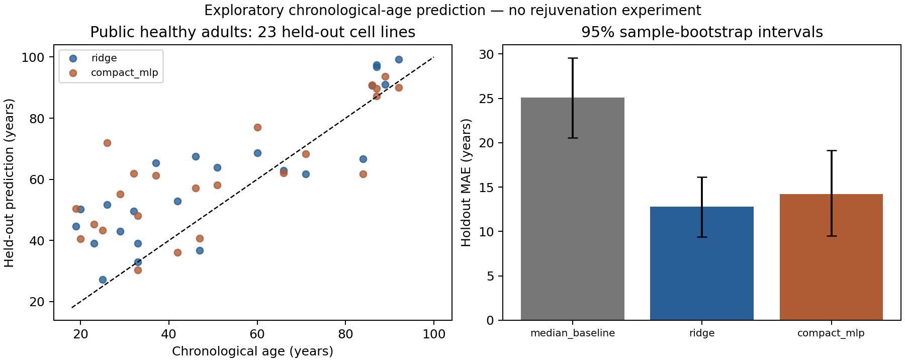

# AI-guided cellular rejuvenation research

**David Xu, PhD; Peter Lee, PhD, MD; and Zhimin Zheng, PhD**

Public research code, preliminary results and nonconfidential planning documents for a proposed AI-guided cellular rejuvenation program. **No biological rejuvenation, validated causal mechanism, proprietary therapeutic target or clinical efficacy has been established.** Comprehensive reversal of cellular biological aging is a long-term research ambition.

## First public-data training result — 21 October 2026

We trained a regularized linear model and a compact neural model on freely downloadable [GSE113957](https://www.ncbi.nlm.nih.gov/geo/query/acc.cgi?acc=GSE113957) fibroblast RNA-seq data generated by [Fleischer et al. (2018)](https://doi.org/10.1186/s13059-018-1599-6). Of 143 samples, 111 healthy adult cell lines qualified; 88 were used for training and 23 for a frozen holdout. This is one cohort, not external validation.

| Model | Holdout mean absolute error, years | Conditional 95% bootstrap interval |
|---|---:|---:|
| Training-median age | 25.07 | 20.59–29.59 |
| Ridge | 12.79 | 9.39–16.15 |
| Compact neural network | 14.24 | 9.53–19.17 |

Both learned models passed the predeclared comparison with the median baseline. The neural network **did not establish superiority over Ridge**. Its 145 neural weights and biases are in addition to fitted PCA and preprocessing parameters. The result tests a reproducible analysis pipeline; it does not show cells becoming younger or support a best-in-class aging-clock claim.

**Material limitations:** only 23 held-out cell lines; one random split; train median age 62.5 versus holdout median 46; possible culture, sex, ancestry and platform confounding; public cell IDs are only a donor proxy. In the 14 held-out samples below 60, Ridge MAE was 15.84 years and R² was −2.41. Broad-range correlation does not mean useful accuracy throughout adulthood. Bootstrap intervals condition on this split and these fitted models.



Read the [full study report](results/pilot_20261021_v2/REPORT.md), [model card](results/pilot_20261021_v2/MODEL_CARD.md), [metrics](results/pilot_20261021_v2/metrics.json) and [independent verification](verification/REPORT.md). Verification passed 103 checks and all seven tests, including deliberate prediction corruption. This is independent software/numeric checking, not biological validation.

## Reproduce locally

Tested with Python 3.12.14 on CPU, one numerical thread. No paid datasets, GPU or cloud training were used. Downloaded processed inputs total about 7.55 MB; full model fitting took about 2.2 seconds here, excluding setup, downloads, development and verification. Other computers may differ.

```bash
git clone https://github.com/xuda1979/anti-aging.git
cd anti-aging
python -m venv .venv
source .venv/bin/activate
python -m pip install -r requirements.txt
python scripts/download_data.py
PYTHONPATH=src python -m unittest discover -s tests -v
python scripts/verify_study.py --run pilot_20261021_v2
python scripts/predict.py --sample GSM3124569
```

To repeat training, choose a new run ID; existing runs are never overwritten:

```bash
python scripts/train.py --run-id local_replication_001
python scripts/verify_study.py --run local_replication_001
```

`configs/protocol.json` freezes eligibility, split, feature rules, Ridge search, neural architecture, metrics and acceptance before fitting. Transcript filtering, log transformation, feature selection, scaling, PCA and model selection use training folds only. The trained models retain the original holdout boundary and are not refitted on all 111 samples. Predictions are research outputs with no clinical interpretation. Load serialized Python model files only from a trusted, hash-verified source.

Source downloads fail closed on checksum mismatch. If GEO changes a file, preserve the failed check and review the metadata change rather than silently replacing its expected digest. Models and predictions are retained with SHA-256 manifests. V1 is explicitly marked **VOID** for a post-run example-path change; V2 reran the unchanged protocol with frozen source and identical scientific predictions. See the [run status register](results/RUN_STATUS.json).

## Project materials

- [New public-data pilot addendum](docs/business/Cellular_Rejuvenation_Public_Data_Pilot_2026-10-21.pdf)
- [Technical white paper](docs/business/Cellular_Rejuvenation_White_Paper.pdf) and [editable source](docs/business/Cellular_Rejuvenation_White_Paper.docx)
- [Investor brief](docs/business/Cellular_Rejuvenation_Investor_Brief.pdf), [pitch deck](docs/business/Cellular_Rejuvenation_Nonconfidential_Pitch_Deck.pdf) and [editable slides](docs/business/Cellular_Rejuvenation_Nonconfidential_Pitch_Deck.pptx)
- [Diligence review](docs/business/Cellular_Rejuvenation_Diligence_Review.pdf) and [illustrative financial plan](docs/business/Cellular_Rejuvenation_Financial_Plan.xlsx)
- [Next scientific and business milestones](docs/ROADMAP.md), [data card](data/processed/DATA_CARD.md), [rights and attribution notice](NOTICE.md) and [earlier manuscript archive](docs/archive/README.md)

The business documents predate this new training pilot; read them together with the current study report. Their $8 million, 24-month plan is illustrative. Institutional sponsorship, founder role commitments, commercial data/IP rights and clinical results have not been established. The earlier manuscript's separate 34-sample treatment-classification and synthetic studies have not been independently replayed in this release because their accompanying source archive was unavailable.

Private correspondence, investor contact lists, outreach logs and credentials are excluded from this public repository. Public data are credited to their original investigators; no exclusive ownership or unrestricted commercial rights in third-party materials are asserted.

## Research and collaboration

We welcome technical review, independent reproduction, relevant research collaboration and discussions with suitable early-stage funders or employers. Please identify the run and specific evidence when discussing a result. Contact: **David Xu, PhD — exutechnology@gmail.com**. No investment terms, spending commitment or IP assignment is made through this repository.

