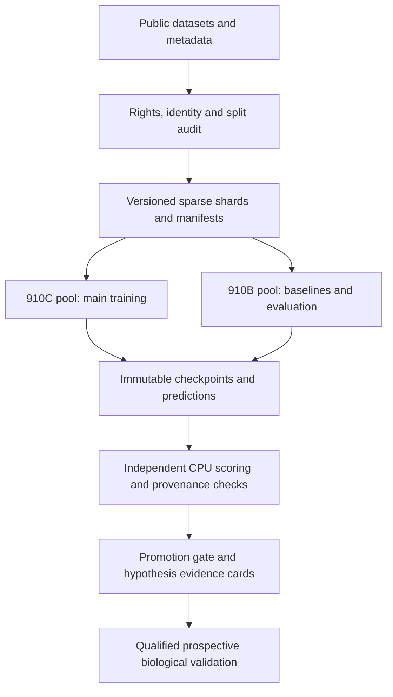
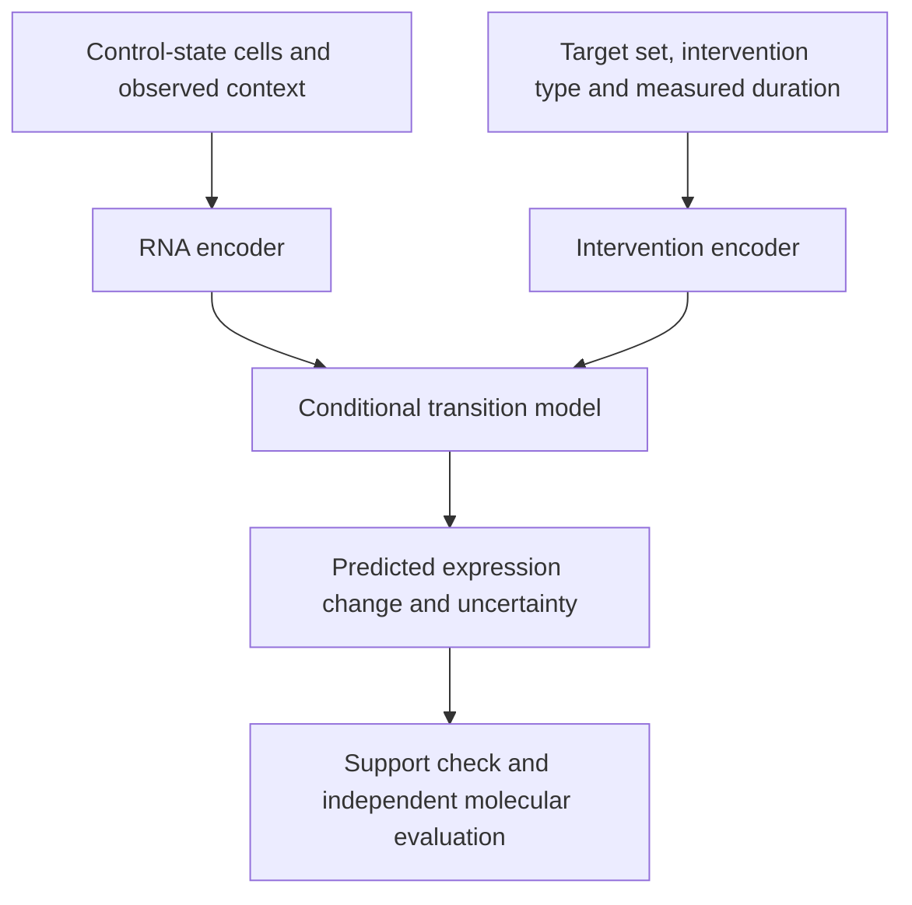

# Cellular rejuvenation R&D plan: 8 Ascend 910C + 8 Ascend 910B

**David Xu, PhD; Peter Lee, PhD, MD; and Zhimin Zheng, PhD**

**Plan date:** 21 October 2026. **Status:** proposed development and experiment contracts; NPU execution has not started. **Planning inventory:** eight 910C and eight 910B NPUs, as supplied by the project initiator. Physical boards, chips and runtime-visible logical devices must be reconciled before setting distributed world size.

Use the [first-30-days checklist](ASCEND_FIRST_30_DAYS.md) for daily work, the [experiment matrix](ASCEND_EXPERIMENT_MATRIX.json) for resource ceilings and dependencies, and the [primary-source register](ASCEND_SOURCES.md) for supporting documentation. This plan extends the [research roadmap](ROADMAP.md). The existing published studies and their frozen protocols remain historical evidence.

## 1. Objective, current evidence and definition of success

The long-term scientific objective is to identify controllable mechanisms that restore function in aged adult cells while maintaining identity and safety. The next development objective is a reproducible NPU research platform that predicts molecular responses to interventions, transfers across independent biological contexts, quantifies uncertainty and produces testable hypotheses.

The first 12 weeks should deliver an auditable computational system and a defensible account of what it can predict. A complete cellular-age reset, a validated rejuvenation mechanism, a proprietary therapeutic target and clinical efficacy remain unestablished. Additional compute cannot resolve those claims without appropriate independent biological evidence.

| Starting artifact | Executed evidence | Constraint on this plan |
|---|---|---|
| [Adult fibroblast study](../results/pilot_20261021_v2/REPORT.md) | GSE113957: 111 healthy adult cell lines; 88 training / 23 held out; Ridge MAE 12.79 years, median baseline 25.07, compact MLP 14.24 | Single cohort; weak younger-adult performance; public cell IDs only proxy donor identity. Preserve the original split and checkpoint. |
| [Independent adult-study verification](../verification/REPORT.md) | 103 checks and seven tests passed | Computational verification; target NPU compatibility is still UNKNOWN. |
| [Recovered CellClockAI reproduction](../legacy/REPRODUCTION.md) | 34 public cultures from three donor labels; treatment classification and six-scenario synthetic benchmark reproduced; 11 compared outputs byte-identical | Treatment status and invented simulator truth do not establish rejuvenation. Optional Torch test was skipped. |
| Current software | NumPy/scikit-learn CPU training, acquisition, prediction, verification and saved models | No production RNA foundation model, HCCL trainer, NPU launcher, multimodal trainer or validated functional-response model exists yet. |

The three near-term success criteria are: a verified 1→2→4→8-device lifecycle **within each pool**; a useful representation or intervention predictor that beats matched simple baselines on frozen independent evaluations; and complete provenance, checkpoints and uncertainty evidence. A smaller model that wins fairly is a successful outcome.

### Falsifiable research hypotheses

| ID | Hypothesis | Observation that rejects or limits it |
|---|---|---|
| H1 | Public-cell representation learning improves an independently evaluated adult aging task over regularized linear/PCA baselines. | No donor-level external improvement; gains explained by study, age-band or cell-composition differences. |
| H2 | Conditioning on intervention and cell context improves unseen-target molecular-response predictions over a control predictor and linear response models. | No improvement in effect prediction; high absolute-expression correlation comes entirely from unchanged genes. |
| H3 | A support-aware interaction model generalizes to held-out combinations and identifies when it cannot extrapolate. | Gains disappear under combination holdout, guide/target de-duplication, context shift or uncertainty calibration. |
| H4 | A computationally nominated mechanism changes independent adult-cell function while preserving identity and safety. | Prospective perturbation/rescue and independent functional evidence fail or are unavailable. Public-data model fitting alone cannot pass H4. |

## 2. Hardware inventory and operating model

### 2.1 Two independently qualified pools

| Pool | User-reported inventory | Initial role | Normal scheduling |
|---|---:|---|---|
| C | 8 × Ascend 910C | Main RNA representation and perturbation-model training after canaries | One 8-device job, two 4-device jobs, or bounded 1/2-device development jobs, subject to actual topology. |
| B | 8 × Ascend 910B | Baselines, independent evaluations, ablations, smaller-model training and reproduction | Independent 1/2-device jobs; reserve evaluation capacity during major C runs. |
| CPU/storage | Not yet measured | Acquisition, metadata, sparse preprocessing, shard construction and independent scoring | Keep preprocessing off scarce accelerators; set workers from measured CPU/RAM/I/O headroom. |

This separation is a project design choice under unknown mixed-hardware compatibility and performance. There is no claimed verified 16-device heterogeneous training configuration. Share versioned datasets and portable checkpoints between pools. An 8-device rank group must contain only devices qualified for that exact job. If the reported count does not equal eight runtime-visible devices, revise launch topology and compute accounting before any distributed run.

If eight same-type devices span multiple servers, qualify intra-server communication first, then the actual cross-server links. If a suitable fabric is absent, use independent jobs or smaller homogeneous groups; avoid relying on an assumed high-bandwidth 16-device fabric.

### 2.2 Inventory required before a launch

The infrastructure owner records physical product/SKU and board-to-logical-device mapping; HBM total/free per visible device; health/ECC/temperature state; CPU architecture and instruction set; host RAM; local NVMe and shared-storage capacity; supported interconnects, link topology and measured collectives; host/device NIC mapping; scheduler and container runtime; firmware, driver, CANN, Python, PyTorch and `torch_npu`; and actual job availability.

Record private host addresses and account details outside the public repository. Publish a redacted topology and software manifest. **HBM, device count exposed per host, interconnect bandwidth, power, throughput and model capacity are UNKNOWN until measured.** No specification from a different 910B/910C system substitutes for the inventory.

## 3. Software qualification and isolation

Use PyTorch plus `torch_npu`, with HCCL for NPU collectives. The vendor compatibility table ties framework packages to CANN and firmware/driver requirements; its TorchNPU product version and pip package version have different naming schemes. [S02–S04]

| Track | Candidate combination | Decision |
|---|---|---|
| Existing verified CPU study | Current repository lock and saved v2 outputs | Preserve in its own environment; establish the scientific reference independently of NPU package changes. |
| New NPU research environment | PyTorch 2.7.1 + `torch_npu` 2.7.1.post8 + CANN 9.1.0, listed under TorchNPU 26.1.0 in the reviewed vendor matrix | A **candidate**, not a verified installation for these servers. Validate product, OS, architecture, Python-wheel ABI and installed driver/firmware support first. |
| Other supported installed combination | Exact tuple from the vendor matrix and the host's supported products/OS | Prefer a qualified existing environment when it passes the same tests. Record the reason and complete lock. |

The candidate does not authorize an in-place driver or system upgrade. The administrator selects a product-supported, digest-pinned image or isolated environment, preserves a rollback image, and verifies one device in each pool. A shared software release may still require different product-specific images. Freeze each pool's image digest and package/driver manifest separately. Compatibility on one pool does not certify the other. [S02–S03]

Start with eager execution, ordinary supported operators and a CPU reference. Use FP32 for the correctness fixture, then qualify BF16 autocast; retain FP32 where the loss, normalization or optimizer requires it. FP16 is a separate experiment with its own overflow checks. Test the selected attention backend explicitly. CUDA-only FlashAttention, fused optimizer or Triton extensions are not assumed portable. The upstream scGPT project has a non-FlashAttention path, but that alone does not establish Ascend compatibility. [S15]

Introduce graph compilation, fused attention, FSDP/optimizer sharding or MindSpeed only after profiling identifies a bottleneck and the release-specific implementation passes lifecycle and scoring checks. Each optimization gets a separate comparison. Avoid a simultaneous framework upgrade, architecture change, new dataset and mixed-precision change.

## 4. System architecture

**Data:** immutable acquisitions, donor/sample/perturbation metadata, feature mappings, split manifests and model-ready shards. **Control:** queued jobs, leases, dependencies, budgets, checkpoint/resume and stop conditions. **Evidence:** complete predictions, environment/code/data hashes, uncertainty, verification and rejected hypotheses.

These are interfaces, not three duplicate copies of every dataset. A run references content-addressed data and a frozen contract. An evaluator can read the checkpoint and sealed evaluation data but cannot change the trainer's targets or declare a favorable replacement split.

## 5. Public, free data acquisition plan

The table identifies accessible research sources, not completed large-scale downloads, verified reuse licenses or final eligible sample counts. Intake must resolve source-specific rights and metadata. Start with processed research files; raw-read reprocessing requires a separate storage/CPU budget. Source URLs and qualification notes are in [ASCEND_SOURCES.md](ASCEND_SOURCES.md).

| Data track | Source and observed scope | Planned use | Principal boundary |
|---|---|---|---|
| Existing bulk adult-age anchor | GSE113957, already executed | Frozen CPU reference and new, separately registered robustness work | 111 eligible adult cell lines cannot support fitting a large age model from scratch. |
| Independent adult fibroblast candidate | GSE307377; official SOFT metadata describes 4 young donors aged 23–33 and 5 aged donors aged 64–72, with raw-count and TPM supplements | Sealed small external age-contrast/transfer audit after donor and measurement mapping | Nine donors and a discontinuous age distribution; independence from training material must be checked. [S08] |
| Longitudinal candidate | GSE241430; three individuals sampled at different ages, with fibroblasts and reprogrammed neurons | Within-person directional aging analysis; use audited fibroblast subset for fibroblast questions | Three independent people; neuronal samples are distinct contexts, not extra fibroblast donors. An ambiguous age string in series metadata needs GSM-level resolution. [S09] |
| General human cell representations | CELLxGENE Census, candidate explicitly dated LTS release `2025-11-08` | Metadata-only query → 100k-cell canary → 1M → at most 5M selected cells if justified | Deduplicate primary cells and underlying donor/study material; healthy adult stromal/skin-relevant contexts first; exclude sealed studies before pretraining. [S05–S06] |
| Single-gene intervention learning | Replogle et al. genome-scale Perturb-seq through the original resource and scPerturb | Start with a bounded K562/RPE1 subset; scale after schema/guide/control audit | Cell-line perturbation transfer is limited; K562/RPE1 are not aged human dermal fibroblasts. Verify each subset's target panel rather than merging different screens by name. [S07, S10] |
| Combination generalization | Norman et al., GSE133344, also catalogued by scPerturb | Held-out combinations and interaction/abstention benchmarks | K562 context, guide/target overlap and reused public cells can leak across datasets. [S07, S11] |
| Treatment/reprogramming anchor | GSE165177, already recovered and replayed | Maintain treatment-association reference and confounding/identity analyses | Three donor labels; treatment discrimination is not a biological-age endpoint. |
| Separate methylation branch | GSE40279, official public aging-methylation record | Independent DNAm pipeline and regularized baselines only after RNA gates | Blood context and a different measurement modality. It is not paired fibroblast RNA/methylation training data. [S12] |
| Exploratory developmental trajectories | GSE36552, public early-embryo/hESC single-cell RNA data | Later exploratory regulatory-timing hypotheses and developmental-confounding checks | Developmental stage is not a measured rejuvenation label; never assign a fabricated “age zero” target. [S13] |

The two named external fibroblast candidates offer **at most 12 people before overlap and eligibility checks**, not a sufficiently powered broad external clock benchmark. Search for additional independent adult cohorts in week 1–2. The external-age promotion gate below requires at least 30 eligible donors across at least two independent cohorts; the current candidate list does not satisfy that requirement. Record INSUFFICIENT_EVIDENCE if intake cannot establish it.

For Census, specify the dated release rather than a moving `stable`/`latest` alias. `is_primary_data` removes documented duplicated cell entries, but is not a donor-independence guarantee. Preserve collection/dataset IDs, original sample identifiers and cross-resource aliases. Check the release's actual schema: metadata semantics can change between releases. [S05–S06]

### Required acquisition record

Each source entry contains accession/release, original investigator/publication, exact retrieved URLs, retrieval UTC time, file size/SHA-256, available license/consent/reuse terms and their review state, species/tissue/assay/units, donor and sample IDs, perturbation/guide/control details, age provenance, exclusions and intended split. Every ingest decision has an owner. A public download with unresolved commercial reuse remains research-only for this program; do not claim an exclusive dataset or invention.

Keep the original files immutable. Derived shards carry a transform hash and their parent file hashes. Acquisition retries use checksums and bounded concurrency; unavailable sources remain missing, with a documented substitute requiring a new data contract.

## 6. Harmonization, independence and split contracts

### 6.1 Common metadata schema

Required fields include `dataset_id`, `source_file_sha256`, `public_sample_id`, `donor_group_id`, `biological_replicate_id`, `technical_replicate_id`, `species`, `tissue`, `cell_type`, `assay`, `measurement_units`, `age_value`, `age_unit`, `age_provenance`, `sex_if_available`, `culture/passage_if_available`, `batch`, `perturbation_targets`, `perturbation_type`, `guide_id`, `control_class`, `dose_if_available`, `time_if_available`, `modality_pair_id`, `split`, and explicit missingness.

Unknown ages, doses and collection times stay missing. A developmental-stage annotation is not a numerical adult age. Repeated cultures, visits and technical replicates belong to the same donor group. Cell lines such as K562 are contexts rather than thousands of independent donors. Store the cross-study donor-alias audit; unresolved overlap prevents an external-independence claim.

### 6.2 Measurement-specific transformations

1. **Bulk RNA:** preserve RefSeq/Ensembl identifiers and versioned one-to-one mapping decisions; report losses and ambiguous mappings. Counts, TPM and FPKM retain different units. The current RefSeq-FPKM Ridge checkpoint must not be fed a new TPM/count matrix as though units and features matched.
2. **External bulk comparison:** either qualify a common raw-read quantification pipeline in a new contract, or freeze a gene/rank-based transfer representation and matched baselines before unsealing outcomes. The latter is a new task and is not directly interchangeable with the old MAE. Fit feature selection, scaling and calibration on development data only.
3. **Single-cell RNA:** use original count layers where required; retain library size and assay metadata; audit doublets, low-quality cells and extreme mitochondrial fractions using development-frozen, assay-appropriate QC. Avoid a universal threshold that removes old or stressed cells preferentially. Track QC retention by donor/condition and keep a sensitivity analysis.
4. **Methylation:** retain probe platform, genomic mapping, beta-value bounds and missing-probe masks; fit imputation/filtering on development data. Blood-cell composition and batch remain explicit confounders.
5. **ATAC, sequence and imaging:** admit only at a later modality gate with a verified dataset and its own preprocessing/quality contract. A proposed encoder does not imply that paired or functional data exist.

Batch correction is fitted within development folds. Any transductive use of evaluation features becomes a separately labelled task with matched baselines, not an inductive external result. Never harmonize all cohorts jointly using evaluation labels.

### 6.3 Separate evaluation axes

| Axis | Frozen unit of separation | Key prohibition |
|---|---|---|
| Adult age | Donor, then study/cohort; all visits and cultures grouped | Reusing the existing 23-cell-line holdout for architecture selection or portraying a random cell split as external validation. |
| Unseen intervention | Perturbed target(s), guide identities and shared source material | Allowing the same target through a different guide or scPerturb mirror into the other split. |
| Unseen combination | Entire target pair, plus a separately defined harder unseen-target-pair regime | Calling a seen single-gene component “unseen gene”; ignoring support for interactions. |
| Context transfer | Entire cell line, donor context or study, as actually available | Treating a batch split within K562 as cross-tissue validation. |
| Time transfer | Held-out measured duration and/or longitudinal donor | Assuming observational pseudotime identifies an intervention's causal time response. |

Create development, validation and sealed final-test manifests **before pretraining**, including exclusion of the final-test studies from representation learning. If a public pretrained model may already contain those studies, mark contamination UNKNOWN and compare it only in a separately disclosed transfer analysis. Use training-only model selection; release all three planned seeds (101, 202, 303) rather than the best seed.

## 7. Model program: useful scale before maximum scale

### 7.1 RNA state encoder

Build an ordinary-operator PyTorch implementation that can be compared against a CPU fixture. Input is a set/sequence of gene IDs, expression values, masks and measured context. Gene identity embeddings and numerical value embeddings are combined; cell type/tissue/assay tokens provide observed context, with an explicit unknown token. Token inclusion/order is fixed by the data contract, not by age labels or evaluation outcomes.

| Candidate | Proposed shape | Approximate parameter target | Initial sequence lengths | Promotion requirement |
|---|---|---:|---|---|
| Linear/PCA and count-VAE baselines | Ridge/elastic net; PCA plus a small head; scVI-style baseline where raw counts and software permit [S14] | Small baseline | Appropriate dense/sparse features | Always retained, with the same held-out biological units. |
| RNA-A | 6 transformer blocks, hidden width 512, 8 heads, FFN 2048, gene vocabulary about 20k | About 30M | 512 canary → 1024; 2048 only after profiling | Beat a matched small baseline; pass all runtime/data gates. |
| RNA-B | 12 blocks, width 768, 12 heads, FFN 3072, same gene vocabulary | About 100M | Start 1024; 2048 conditional | RNA-A must first improve a prespecified development-validation task; at least 1M eligible unique cells and sufficient study/context diversity must pass intake. Final tests stay sealed during this allocation decision. |
| Larger optional model | Freeze only after a documented scaling study | 100–300M ceiling for a later proposal | Measured | Requires a new resource contract; outside the first-month matrix. |

Parameter counts are design approximations; the implemented model must report exact total/trainable counts. About 20k vocabulary embeddings contribute to these totals. No 7B/70B model is required for the primary molecular tasks.

Pretrain with masked expression reconstruction using a development-frozen mixture of expressed and zero-valued genes, so predicting zeros cannot dominate the score. Start with Huber loss on specified log-normalized values and a balanced detection term; evaluate a count likelihood only with its proper raw-count inputs, offsets and a separately registered objective. Record masking/zero-sampling probabilities and sample weights. A value being reconstructed must be masked from its own input. Normalize reconstruction loss by valid masked positions and publish masked/zero-stratified errors.

Use donor/study-balanced sampling and audit whether the latent space preserves biology while encoding dataset identity. A domain-adversarial or contrastive term is an ablation, not an assumed improvement: aggressive removal of batch may remove real age biology. Frozen embeddings plus regularized downstream heads are the first aging transfer test; full encoder fine-tuning on 111 cell lines is unjustified without stronger development evidence.

### Proposed first training configuration

These defaults become executable only after implementation and a frozen run contract; they are starting hypotheses, not tuned results.

| Setting | RNA-A starting contract | RNA-B / response-head comparison |
|---|---|---|
| Optimizer | AdamW; betas (0.9, 0.95), epsilon 1e-8, weight decay 0.01; exclude declared bias/norm parameters from decay | Same for RNA-B; frozen-encoder response head starts at weight decay 1e-4. |
| Learning rate | 3e-4 peak; 5% update warmup, cosine decay to 10% of peak | RNA-B 1e-4; response head 1e-3; tune only within a small, declared development budget. |
| Gradient clipping | Global norm 1.0 after unscaling when required | Same; log norm and clipped-update frequency. |
| Effective global batch | 256 cells at the qualified token-length distribution | Same for matched scaling; changes create a new optimization comparison. |
| Accumulation example | At 8 ranks × microbatch 4, accumulate 8 microbatches per update; at 1 rank × 4, accumulate 64 | Recalculate from actual qualified ranks/microbatch; padding and unequal valid counts require correct global loss weighting. |
| Masking | 15% of selected gene positions; half of scored positions drawn from a declared zero-gene stratum when available | Fix inclusion probabilities and weights; report expressed/zero errors separately and audit a trivial-zero baseline. |
| Exposure ladder | 100k-cell canary; then 1M eligible unique cells × 2 epochs | Up to 5M × 1 epoch only after the smaller study and resource forecast justify it; RNA-B comparison matches exposure. |
| Seeds / selection | Model seeds 101, 202, 303; separate split seed 7919 after donor/study registry is frozen | Same candidate/data contract across model seeds; choose checkpoint on validation only. |
| Response adapter | Freeze encoder initially; cap at 20 epochs, early stopping after 3 validation checks without improvement | Unfreezing is a separate ablation with a smaller LR and its own remaining budget. |

Define Huber/detection loss scales and any auxiliary weights in the development fixture before an expensive run. Account for the global number and weights of valid masked targets across ranks and accumulation steps: averaging local means can bias unequal-length batches. Independently test the distributed gradient against a single-process concatenated-batch reference. If the forecast cannot fit all three seeds within the aggregate cap, reduce the declared comparison before test access or mark it incomplete.

### 7.2 Conditional perturbation-response model

The transition is `z_after = f(z_control, target_set, intervention_type, context, measured_time, measured_dose)`. Missing dose/time use masked fields; they are never invented. In destructive single-cell assays, the same cell usually has no paired pre/post observation. Train against context-matched control/perturbed distributions or replicate-level pseudobulk targets; do not create a fictional cell-level ground-truth pairing.

Start with a small residual MLP over a frozen RNA encoder and target embeddings. Add a low-rank pair interaction term only after single-target baselines pass. Gene priors or regulatory graphs are versioned hypotheses, with train-only fitting and an ablation without the prior. A gene omitted from intervention support must trigger an OOD/support warning. Evaluate distributional predictions only when the assay has adequate replication; cell resampling cannot replace biological replicate uncertainty.

Train the predictor on molecular response, not on a single age-clock score. Keep age heads, cell-identity probes and eventual functional assays as separately versioned evaluations. Public perturbation data can support prediction of observed intervention-associated effects; causal interpretation still depends on experimental design, guide specificity, controls, selection and transport assumptions.

### 7.3 Multimodal and temporal extension

RNA first establishes the common data and evaluation interfaces. Later add methylation/probe, ATAC/region, sequence and image encoders only where a source audit establishes relevant measurements. Use modality masks and an explicit pairing key. Fit paired fusion on genuinely paired samples/cells; unpaired integration is a separately tested alignment hypothesis with unimodal and shuffle-pair controls.

Use measured intervention duration and longitudinal visits as explicit coordinates. Short cell-state responses, later function and donor lifetime age are different labels and clocks. A temporal model may use context-specific time embeddings or a conditional transition over actual measured intervals; its forecast is tested on withheld time intervals. Developmental trajectories can generate hypotheses, but adult identity preservation remains an independent requirement.

### 7.4 Hypothesis discovery and prioritization

Generate candidate mechanism cards from replicated response patterns, regulatory-prior evidence and original-source literature. Literature models and an optional Future-Code workflow may collect evidence, schedule experiments and audit contradictions; source-backed task manifests remain domain-specific project inputs. No changes to the general Future-Code platform or claims of new platform capabilities are implied by this plan.

Rank hypotheses using separately reported components: intervention-response support, transfer consistency, uncertainty, independent functional evidence if present, identity-risk evidence, practical assay feasibility and contradictory observations. Missing functional evidence is visibly missing. Use a Pareto shortlist rather than silently converting a younger expression score into a functional benefit.

A hypothesis card records proposed mechanism, alternative explanations, relevant donors/contexts, effect and uncertainty, data/model hashes, known support limits, orthogonal validation and rescue predictions, withdrawal/persistence questions, identity/safety concerns and rejection criteria. Public association genes remain hypotheses. A proposed shortlist of 20–40 cards is a deliverable, not a validated target portfolio.

## 8. Implementation work packages and PR sequence

All paths below are **proposed future files**, except the existing CPU modules named explicitly. This planning PR does not add a working NPU trainer or launcher.

| PR slice | Proposed scope | Required acceptance before the next slice |
|---|---|---|
| I1: inventory and contracts | `infra/ascend/`, environment manifest schema, topology inventory, job contract and CPU/NPU device abstraction | Actual one-device reports from both pools; complete package/driver pins; explicit UNKNOWN fields fail launch admission. |
| I2: versioned biological data | `src/rejuvenation/data/`, source registry, sparse sharder, donor aliases, sealed split manifests | Synthetic schema fixtures plus bounded real-data canary; duplicate/overlap and wrong-units records rejected; deterministic shard hashes. |
| I3: portable RNA-A | `src/rejuvenation/models/`, CPU reference and eager NPU trainer | Same fixture, finite forward/backward, parameter updates, independent loss recomputation and checkpoint/resume on each pool. |
| I4: distributed lifecycle | `src/rejuvenation/training/`, HCCL launch, sampler/gradient accumulation and atomic checkpoints | 1→2→4→8 correctness/performance evidence; injected rank failure exits all workers; restart preserves optimizer, scheduler and sampler state. |
| I5: frozen evaluations | `src/rejuvenation/evaluation/`, baseline runners and independent scorer | No empty-set pass; wrong checkpoint/split/protocol rejected; corrupted prediction detected; full donor/perturbation-level output retained. |
| I6: perturbation adapter | Transition head, control matching, target/combination/context splits and abstention | Beat control and linear baselines under the frozen support/transfer contracts; all failing strata remain visible. |
| I7: scaling/optimization | RNA-B; qualified precision/attention/sharding or compilation ablations | Incremental value per NPU-hour and numerical guardrails; no silent backend/fallback change. |
| I8: multimodal/biology handoff | Relevant paired-data intake, independent probes and hypothesis cards | Pairing and data-rights audit; prospective plan reviewed by experimental lead; evidence stage remains explicit. |

Extend existing modules through clear interfaces; preserve `configs/protocol.json`, published v2 source/result/model hashes and historical archive bytes. New objectives, feature harmonization, splits and scoring rules get new protocol IDs. Never overwrite old outputs under an existing run ID.

## 9. First-month experiment matrix and compute ceilings

The companion [JSON matrix](ASCEND_EXPERIMENT_MATRIX.json) is a planning register, **not an executable training configuration**. All runs are PLANNED; actual NPU usage and scores are null. Each row is an aggregate ceiling including its seeds, canaries, retries, evaluation and aborted jobs, not a per-run allowance.

| ID | Experiment / output | Dependencies | 910C device-hours cap | 910B device-hours cap |
|---|---|---|---:|---:|
| P00 | Inventory, version qualification, communication checks | None | 32 | 32 |
| P01 | Portable tiny lifecycle and restart parity | P00 | 64 | 64 |
| P02 | 100k-cell data and input-throughput canary | P00 | 128 | 128 |
| P03 | Matched baselines and frozen evaluation implementation | P01, P02 | 128 | 256 |
| P04 | RNA-A: 100k→1M cells; three-seed evaluation | P03 | 512 | 128 |
| P05 | RNA-B scaling ablation, conditional on useful RNA-A | P04 | 512 | 0 |
| P06 | Single-target and combination-response adapters | P03, P04 | 448 | 256 |
| P07 | External/context transfer, calibration and confounding audit | P04, P06; resolve optional P05 before final-test access | 128 | 128 |
| P08 | Independent release and hypothesis evidence cards | P07 | 96 | 32 |
| **Total, days 1–30** | **Upper limits, not a utilization target** | Gate-dependent | **2,048** | **1,024** |

At the reported eight devices per pool, a continuous week has 1,344 nominal device-hours per pool; four weeks have 10,752 across both pools. The 3,072-hour first-month ceiling uses about 28.6% of that nominal capacity, leaving room for other projects, downtime and rejected experiments. These calculations assume eight schedulable logical devices in each pool and no maintenance. Reconcile them with the measured device inventory and availability.

Start with a canary lasting at most 30 minutes on one device; each full distributed job has a maximum 48-hour wall cap. For example, an 8-device job at that cap would consume 384 device-hours, which must fit the remaining aggregate row budget. Stop at the first cap reached. A retry consumes the same row's remaining budget. Scale-up cannot borrow another row's budget silently. First-month caps do not authorize later months or paid cloud resources.

Use `device_hours = allocated_logical_devices × elapsed_wall_seconds / 3600`, recorded separately for B and C, including failed jobs. Report completed optimizer steps, real/padded tokens, unique cells/biological units and outcomes with those hours. Existing hardware still incurs electricity and operating costs; their prices are unknown and require a local cost model.

### Scheduling priorities

1. Reserve the smallest topology sufficient for the next gate. Give P00–P03 priority over a large pretraining reservation.
2. On C, schedule one main job and disjoint ablations only when the allocation fits. An eight-device job owns the whole qualified eight-device group.
3. On B, normally leave two devices available for independent evaluation and use the other six for small jobs. Reservation counts are scheduler allocations, not guaranteed concurrent performance.
4. Transfer versioned data/checkpoints rather than cross-pool gradients. Each pool measures its own throughput and precision behavior.
5. If only four devices per pool are available, keep the scientific task/split fixed, reduce parallelism and revise wall forecasts from measurement. Do not reinterpret fewer steps as equivalent training.

## 10. Data, memory and performance engineering

### 10.1 Sparse storage and streaming

Use immutable CSR/CSC source representations or appropriately chunked H5AD/Zarr for preprocessing; training consumes deterministic, indexed shards with manifest hashes and offsets. Stage a read-only copy onto local NVMe. A training reader opens only committed shards; a writer commits a temporary shard atomically, then updates the versioned index. Do not concurrently mutate an HDF5 dataset that active workers are reading.

Keep raw acquisition, normalized features and tokenized views separate with parent references. Avoid duplicating entire matrices for every seed. Partition train/validation/test before fitting gene filters, discretization and token rules. Cache only deterministic transforms under their full input/config hashes.

One million cells × 20,000 genes × four-byte values is **80 GB decimal before metadata or copies**. Dense all-cell materialization and attention over every gene are therefore poor defaults. Sparse storage, bounded token lengths and minibatch densification protect CPU RAM and HBM. Exact storage after filtering is measured, not inferred from this example.

A provisional working allocation is 2 TB for selected processed data/cache and 1 TB for checkpoints/evidence, conditional on actual free space and source sizes. These are reservations to size, not measured usage or requirements to download all of Census. Begin with metadata and a 100k-cell shard. Store only justified views, but retain irreplaceable original data, final checkpoints, manifests and diagnostic evidence; cleanup follows the declared retention policy.

### 10.2 Memory planning

For full Adam-style training, a simple unsharded FP32 parameter/gradient/two-moment estimate is `16 × P` bytes: about 0.48 GB for 30M parameters and 1.60 GB for 100M, decimal. Additional master/cast copies may increase that amount. Activations, attention intermediates, optimizer implementation, workspaces, communication buffers, padding and allocator fragmentation are **additional** and may dominate.

DDP replicates state; it does not automatically divide this memory by eight. FSDP/ZeRO-style sharding has different storage and communication behavior and needs separate qualification. Begin with microbatch 1–4 and length 512, measure peak allocated/reserved HBM, then increase one dimension. Maintain a proposed 20% free-HBM margin under steady-state worst batches. Activation checkpointing, length buckets and gradient accumulation precede complex tensor/pipeline parallelism.

With ordinary dense attention, the length-squared term means moving from 1,024 to 2,048 positions can roughly quadruple the attention component. Only profiling on the selected backend establishes actual end-to-end cost. Padding can erase gains; report both non-padding and processed token throughput.

### 10.3 Scaling measurements

For fixed global batch, optimizer, data order, length distribution and measured optimizer-step count, compare 1, 2, 4 and 8 devices within the same pool. A strong-scaling report uses `S_n = throughput_n / throughput_1` and `E_n = S_n / n`. Compare scientific results under equivalent optimizer updates and data exposure; changing global batch creates a separate optimization experiment.

Proposed engineering targets: E4 ≥ 0.70 and E8 ≥ 0.60 on the qualified workload, with input stall below 10% and no unexplained host fallback. A failed efficiency target calls for profiling or smaller independent jobs; it does not invalidate an otherwise correct scientific model. Separate cold compilation/startup time from steady-state throughput, but include both in total wall cost.

Estimate job duration from measured aggregate processed-token rate and a frozen exposure target: `training_seconds ≈ target_processed_tokens / measured_tokens_per_second`, then add measured checkpoint, evaluation and startup overhead. This is a forecast, not an achieved runtime. If the target exposure cannot fit the row cap, reduce scope in a new declared contract or record an incomplete experiment.

## 11. Runtime correctness, recovery and monitoring

### 11.1 Launch ladder

| Gate | Required evidence | Initial bound / failure action |
|---|---|---|
| G0: inventory | Actual supported tuple, healthy devices, writable isolated output, sufficient storage and valid manifests | Missing hardware/environment fields → UNKNOWN; no admission to training. |
| G1: tiny lifecycle | Load → forward → independently checked loss → backward → update → save → terminate → resume → evaluate | One device, ≤30 minutes each pool; no finite loss/update or wrong restored state → FAIL. |
| G2: numerical parity | Same FP32 fixture and weights across CPU/B/C; finite updates; explicit per-tensor differences | Proposed FP32 loss relative tolerance 1e-4, gradient tolerance 1e-3 with 1e-5 absolute floor; freeze before execution and investigate failures. |
| G3: AMP qualification | Compare BF16 fixture with FP32; stable short loss trace, no silent skipped-update accumulation | Proposed ≤1% fixture-loss difference and gradient cosine ≥0.99; a failure blocks AMP, with FP32 available as a measured fallback. |
| G4: distributed lifecycle | Correct all-reduce, gradient accumulation, unique sample accounting, sampler epochs and checkpoint state on 2/4/8 | Fixed fixtures; terminate one worker and verify coordinated failure and bounded restart. |
| G5: real-data canary | Valid data contracts, nonzero parameter movement, finite losses, measured input/HBM/throughput, complete checkpoint | 100–500 updates and within row/wall caps; inspect the first failure, preserve evidence. |
| G6: scientific promotion | Frozen independent evaluations and the task-specific criteria below | No evaluation, missing cells/strata or stale checkpoint → UNKNOWN/FAIL, never PASS by training loss. |

The numerical tolerances are proposed acceptance contracts, not measurements or universal hardware guarantees. Freeze a small, non-degenerate fixture and its reference outputs before the NPU run. Tolerances can be revised only through a documented new contract with an explanation; preserve the failed result. Stochastic large-scale runs need statistical reproducibility, not a claim of bitwise identity across kernels/devices.

### 11.2 Checkpoint contract

Save model tensors, optimizer and scheduler state, AMP/scaler state where applicable, global optimizer step, all RNG states, data epoch, shard/cursor/sampler state, gradient-accumulation position or a clearly restricted optimizer-boundary save, configuration and code/data/runtime hashes. Sharded saves require all ranks and a final complete manifest. Write to a temporary location, verify contents and hashes, then commit atomically. An incomplete directory is never the latest-good checkpoint.

Checkpoint at least every 30 minutes and on planned stage boundaries, adjusted so measured checkpoint overhead stays below 5%. Retain a latest-good resumable checkpoint, the selected development checkpoint and the final evaluated artifact. Test an uninterrupted versus interrupted/resumed fixture with the same next batch, LR, update and scoring results. Changing world size requires a separately tested reshard/resampler path; otherwise restart from a supported boundary with exposure differences disclosed.

Cross-pool transfer first reloads weights on CPU, then evaluates a fixed fixture on the destination pool. Optimizer state portability is independently tested. Load only trusted hash-verified serialized artifacts. Model tensor exchange may use a safe tensor format when supported; optimizer serialization retains its separate trust requirements.

### 11.3 Telemetry and stop policy

Every run emits job/rank ID, stage, optimizer step, valid examples/tokens, learning rate, loss components, finite-gradient/update indicators, masked/zero proportions, actual batch/global accumulation, data stall, step time, HBM allocated/reserved, device health, checkpoint age/integrity, evaluation progress, data/code/config IDs and cumulative device-hours.

Inspect launch/first updates closely, then use 30–60-second progress records and five-minute health summaries during stable training. Trigger immediate handling on nonfinite values, a rank failure, checksum mismatch, identity/split contamination, storage danger or stalled steps. Preserve the first causal error, the latest-good checkpoint and a compact reproduction bundle. Do not keep launching identical failures.

Proposed stop limits: zero progress for the greater of five minutes or three times the qualified p99 step time; sustained input stall above 30% over ten minutes; less than 15% storage free or less than two projected checkpoints of headroom; three consecutive AMP-skipped updates; any NaN/Inf, invalid split or exhausted budget. These become an executable contract only in a later implementation PR. A transient unchanged retry is limited to one, within the same budget; all other retries require a changed hypothesis and a passing canary.

Use the existing scheduler if available. Otherwise a small per-pool queue with an atomic resource lease, owner/job ID, allowed devices, expiry and heartbeat is sufficient. A second monitor must not relaunch an already healthy job. Private HCCL/rendezvous networking follows the administrator's approved configuration; this plan contains no firewall, permission or credential modifications. [S04]

## 12. Scientific evaluation and promotion

Freeze primary metrics, units, baseline selection, exclusions and subgroup policies before unsealing each evaluation. The original 23-sample result is not a new development validation set. All reported results identify checkpoint, protocol and source hashes.

| Task | Primary comparison | Proposed promotion criterion | Independent uncertainty / guardrails |
|---|---|---|---|
| External adult-age transfer | Donor-level MAE against best development-selected linear/PCA baseline under the same harmonization | ≥10% relative MAE reduction and positive lower 95% CI for paired baseline-minus-candidate error; ≥30 eligible donors across ≥2 independent external cohorts | Donor-cluster bootstrap, 2,000 draws; report each cohort, continuous-age coverage and age-band performance. No material cohort regression (>5% relative MAE) hidden by pooling. |
| Unseen-target response | Macro target/biological-replicate Δ-expression RMSE versus both matched-control and development-selected linear response baselines | ≥10% relative RMSE reduction versus the stronger baseline, with positive paired-improvement lower 95% CI | Cluster on held-out targets/biological units, not individual cells. Minimum 30 held-out target units for promotion; fewer provide descriptive evidence only. |
| Unseen combinations | Same Δ-response metric under declared seen-component and unseen-component regimes | Same improvement rule, applied separately to each supported regime | Report unsupported combinations, uncertainty and failures. Context transfer is a separate gate. |
| Identity / off-context robustness | Independent cell-identity probes; cohort/assay/cell-composition confounding controls | No promotion through missing identity evidence or an unexplained subgroup collapse | Molecular probes are guardrails, not substitutes for measured function or safety. Missing biological endpoints remain UNKNOWN. |
| Calibrated abstention | Held-out support/OOD contexts; error versus coverage | At 80% retained coverage, risk must improve over full coverage and random abstention, with uncertainty; proposed 90% interval coverage within 85–95% on an adequately sized unit-level test | Freeze interval construction/calibration on validation; show sample counts and calibration by context. An interval on expression does not certify intervention safety. |

For small cohorts, report exact donor counts and descriptive paired changes without manufacturing power from thousands of cells or bootstrap replicates. Three model seeds measure algorithm variability, not three new biological studies. Use a fixed three-seed ensemble selected on validation for the primary final prediction if the contract declares it; also publish all individual seeds and their costs. Incomplete seed coverage is disclosed and blocks the declared ensemble's promotion.

Additional diagnostics include age-matched/control-only models, batch and library-size predictors, shuffled labels/targets within justified blocks, target/guide duplication checks, per-cell-type effects, all-gene versus affected-gene errors, Δ-effect direction/cosine similarity, loss by expression abundance and held-out study identity. A differential-expression gene list chosen from final-test outcomes is an oracle diagnostic and cannot drive model selection or the primary endpoint.

For multiple architectures/tasks, freeze one primary comparison per promotion decision and report all attempted candidates. Use validation for search, and either a prespecified multiplicity correction or a new untouched test for subsequent confirmatory claims. Report null/negative results and failed transfer; do not select a favorable seed, subgroup or cell type after looking at the test.

## 13. Twelve-week execution schedule and six-month extension

Weeks are relative to the kickoff and actual resource access. The machine inventory and named research staffing remain dependencies; dates are not completion claims.

| Period | Critical work | Deliverable / decision |
|---|---|---|
| Days 1–3 | Inventory both pools; source/rights and donor-alias intake; isolate software; preserve CPU evidence | Redacted hardware manifest, supported environment tuple, candidate data registry; G0 decision. |
| Days 4–7 | Tiny lifecycle, restart and 1/2-device tests; 100k-cell data canary; independent scoring fixtures | G1–G3 and data-integrity evidence; failure here keeps larger allocations blocked. |
| Week 2 | 4/8-device qualification; frozen age/target/combination/context evaluations; small baselines | G4/G5, input/collective profiles and exact first-model/data contract. |
| Weeks 3–4 | RNA-A scale ladder; matched baselines; conditional RNA-B trial and first response adapter | Complete first-month matrix within C2,048/B1,024 hours; a scorecard including failures and unused budget. |
| Weeks 5–6 | External adult-cohort audit; unseen targets and guide/target contamination checks; replication seeds | H1/H2 transfer assessment. If donor requirements fail, retain age results as exploratory and prioritize data/partnership acquisition. |
| Weeks 7–8 | Combination/generalization and context/temporal transfer; calibration and abstention | H3 report, support map, contradictory results and selected checkpoint or explicit no-promotion outcome. |
| Weeks 9–10 | Admit one relevant paired modality only if data pairing/rights/labels pass; otherwise strengthen RNA transfer | Unimodal/fusion/shuffle-pair ablation or documented defer; no synthetic pairing claim. |
| Weeks 11–12 | Independent reproduction; provenance/claim audit; 20–40 hypothesis cards; investor/research evidence package | Release candidate with measured NPU costs, verified outputs, unresolved risks and a next experiment justified by value of information. |
| Months 4–6, conditional | Secure experimental leadership and access; preregister prospective perturbation/rescue, new donors, independent function/identity and persistence/safety assessments | H4 can be evaluated only when actual biological data arrive; replicate and reject as warranted. Budget/ethics/access and protocol are separate work products. |

Weeks 5–12 require a new measured resource forecast after the first-month gate. Do not extrapolate benchmark throughput into a guaranteed research timeline. The earlier $8M/24-month business plan is illustrative and is not a committed budget for this schedule.

## 14. Biological validation interface

The experimental lead must define a relevant adult-cell function and therapeutic context before a mechanism claim is tested. Compare AI-, expert- and random-eligible target selection under matched resources with prespecified controls, biological replicate units and blinded/independent analysis where feasible. Molecular-age measures are secondary when the objective is functional rejuvenation.

The prospective design should test orthogonal perturbation/rescue, new-donor replication, maintained identity, independent functional readouts, withdrawal/persistence and adverse-state outcomes. Specific experimental materials, doses, assays and sample sizes require that qualified team and pilot variance; the current public data cannot establish a powered final wet-lab sample size. Cell proliferation, selection or dedifferentiation may mimic a younger molecular signature and require explicit alternative-explanation tests.

Optimize experiment selection only within supported, experimentally reviewed actions. A calibrated response model may prioritize information gain, expected functional benefit and diversity with an uncertainty penalty, but the functional component is not computable as observed truth until those assays exist. Rejected hypotheses and negative assays feed a versioned update; each new optimization target gets a new contract.

## 15. Roles, risks and decision ownership

Authorship does not establish staffing or founder commitments. Assign named owners at kickoff; the roles below are proposed responsibilities with assignees **TBD**, not commitments by the three authors.

| Role | Accountable work | Evidence it signs |
|---|---|---|
| Scientific/computational lead | Hypotheses, task priority, model/data contracts and biological interpretation | Frozen experiment decisions, complete results and hypothesis cards. |
| Data engineer / curator | Acquisition, rights status, metadata, donor aliases, gene mapping and sealed splits | Source/shard manifests, exclusions and contamination audit. |
| NPU infrastructure owner | Supported stacks, topology, allocation, collectives, health, storage and recovery | G0–G5 runtime reports and actual cost ledger. |
| ML implementer | Portable model, training, controls and bounded experiments | Tested source, job contracts, checkpoints and predictions. |
| Independent evaluator | Frozen scoring, numerical recomputation and tamper detection | Signed PASS/FAIL/UNKNOWN/INSUFFICIENT_EVIDENCE with limitations. |
| Experimental lead | Functional endpoints, intervention feasibility, identity/safety and prospective biology | Reviewed biological protocol and actual assay evidence. |

One person may cover multiple development roles, but the critical scoring/review path must remain independent of the model producer. Public materials do not assert institutional sponsorship, lab access, commercial IP rights, accepted roles or funding.

| Risk | Early signal | Owner / response |
|---|---|---|
| Version or operator mismatch | Import/kernel failure, CPU fallback, missing device | Infrastructure: isolate and pin a supported tuple; reduce to a small fixture. |
| Unusable fabric or misleading device count | Collectives fail or eight-rank mapping differs from physical count | Infrastructure: revise topology; run independent homogeneous jobs. |
| Pseudoreplication / leakage | Donor aliases, guides, mirrored datasets or test studies overlap | Data/evaluator: freeze affected claims; rebuild a new split and rerun. |
| No external age power | <30 eligible independent donors or age/assay coverage fails | Scientific lead: record insufficient evidence; acquire better data rather than enlarge the age head. |
| Large model adds no value | RNA-B fails matched improvement per cost | ML/evaluator: retain RNA-A or the simpler baseline; release the negative scaling result. |
| Cell-state or identity confounding | Improvement tracks cell cycle, selection or dedifferentiation | Experimental/scientific lead: restrict claims and test independent functional alternatives. |
| Unsupported target/context | OOD error, poor uncertainty or no relevant fibroblast intervention labels | ML/evaluator: abstain, document transfer limits and seek relevant experiments. |
| Run cannot be resumed / storage pressure | Incomplete checkpoint, lost cursor, shrinking headroom | Infrastructure: stop, preserve latest-good state, repair and prove restart before relaunch. |
| Attractive investor claim exceeds evidence | Clock movement described as reversal, or hypothesis called validated | Scientific lead: correct the claim and attach exact evidence level; no commitment or efficacy claim. |

## 16. Release and operating discipline

Each promoted computational release includes exact code revision, source and transform manifests, environment/image digests, protocol/split hashes, seeds, trainable/total parameter counts, data exposure, per-unit predictions, all attempted-run outcomes, uncertainty/subgroup/calibration results, runtime/HBM/scaling profiles, actual B/C hours, checkpoint/resume evidence, an independently verified model card and a rights/claim statement.

Publish only nonconfidential approved materials. Large data/checkpoints may stay in access-controlled storage with public manifests when rights, size or privacy require it. Private correspondence, investor lists, host credentials and private host/network details stay outside public code. The official upstream security guidance should inform administrator-run deployment. [S04]

A model is promoted for a named computational task only. A biological mechanism requires its separate prospective evidence. A funding discussion is separate from validation or a commitment. The next concrete action after this planning PR is **I1: collect and review the two hardware/software inventories, then implement and verify a one-device lifecycle on each qualified pool**. The [first-30-days checklist](ASCEND_FIRST_30_DAYS.md) provides the work order.
