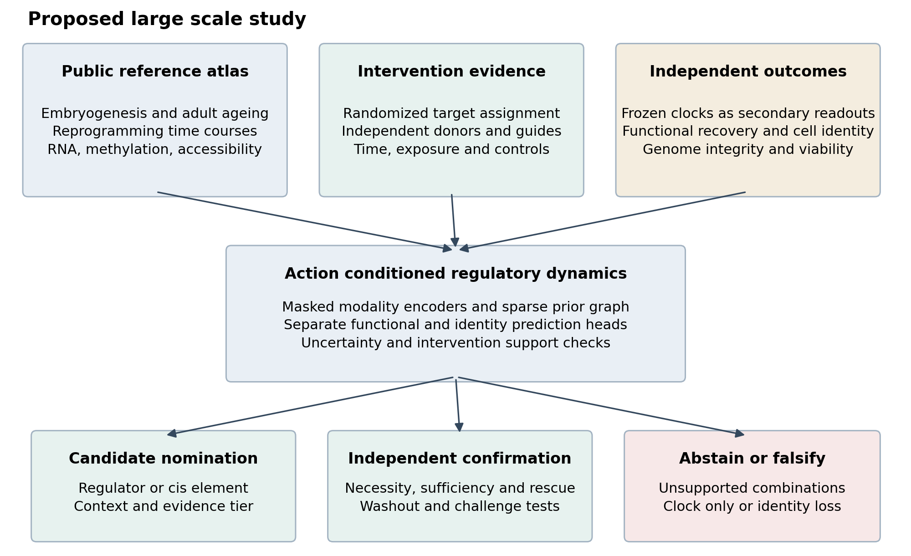
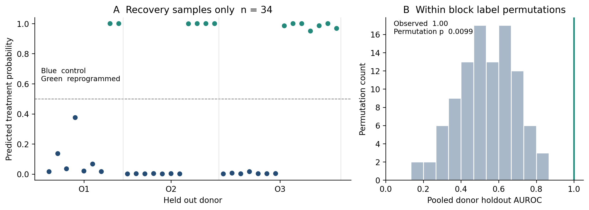
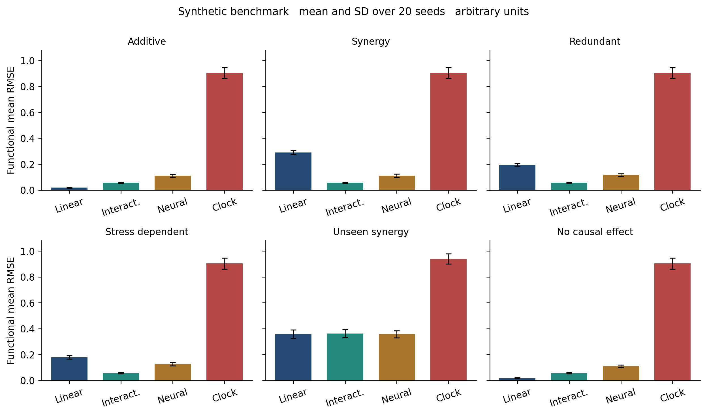
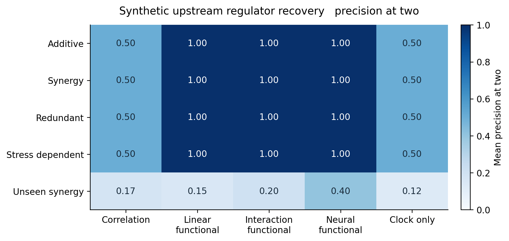
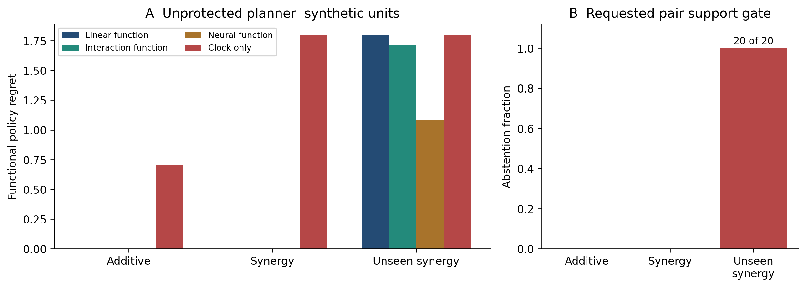

**China Mobile Research Institute, Beijing, China**

**Article type** Research framework with reproducible public data and synthetic computational pilots

# Abstract

Embryogenesis and cellular reprogramming motivate the hypothesis that mammalian cells possess regulatory mechanisms capable of restoring aspects of a youthful state. A decrease in an ageing clock, however, does not establish removal of all biological damage, a universal zero age, or a single switch encoded in DNA. We develop a falsifiable artificial intelligence framework for identifying the regulatory control of age resetting while separating molecular readouts, functional recovery and cellular identity. The proposed study integrates developmental methylomes, paired single cell multiomics, adult ageing references and perturbation data. An action conditioned regulatory model predicts functional outcomes and identity under interventions, with explicit uncertainty and support checks. Candidate mechanisms must pass tests of temporal precedence, necessity, sufficiency, rescue, persistence and replication. We execute two computational pilots. In public human fibroblast RNA sequencing data, 34 recovery samples from three donors yield a treatment classification AUROC of 1.00 under donor holdout, demonstrating a reproducible expression signature without identifying a rejuvenation mechanism. In six synthetic settings with 20 seeds each, interaction modelling recovers observed cooperative effects, whereas optimizing a manipulable clock selects a functionally ineffective reporter. Removing all observations of the essential cooperative intervention defeats extrapolation and triggers a support based abstention rule. The results establish a reproducible feasibility and falsification study. They provide neither an experimentally validated human rejuvenation target nor evidence of lifespan extension. The central research objective is to identify the smallest reproducible regulatory intervention set that restores independent functional measures while preserving identity and genomic integrity, and to determine whether such control is concentrated in a few regulators or distributed across a resilient network.

**Keywords** cellular ageing; embryogenesis; epigenetic clocks; causal inference; multimodal learning; regulatory dynamics; reprogramming; functional validation

# 1 Introduction

The ability of a new organism to develop from parental germ cells raises a concrete mechanistic question. Which processes restore a reproducible starting state despite the age and molecular history of the parents? Epigenetic clock analyses support a decline in estimated age during early mammalian development. In mouse datasets, the inferred minimum frequently occurs near E6.5 to E7.5, although its location varies with the clock and dataset [1]. Human analyses also support an early developmental decline, using preimplantation samples, postimplantation tissues and pluripotent cells as proxies for otherwise inaccessible stages [2]. These observations motivate investigation of resetting; they do not measure every component of cellular ageing or establish that all human embryonic cells become literally zero years old within a fixed number of weeks.

An epigenetic clock is a statistical mapping from molecular measurements to a training target [3]. Its predictions in embryos can be outside the biological domain on which it was calibrated. In particular, an adult blood trained model can assign an age to an embryo without that number having the same interpretation as an age prediction in adult blood. Mean methylation, a selected CpG score, replicative history, mitochondrial dysfunction and organismal mortality are distinct variables. Development changes lineage composition, proliferation, metabolism and gene regulation simultaneously. Any proposed explanation must account for these dependencies.

The hypothesis of a more fundamental mechanism deserves a sharper formulation than the assertion that observed methylation changes or telomere changes are superficial. A molecular modification can be a cause, a mediator, an adaptation or a downstream reporter in different contexts. For example, reprogramming studies have combined changes in epigenetic readouts with functional outcomes, and targeted perturbations can implicate particular components of those processes [10,11]. Causality enriched methylation analyses further distinguish potentially damaging and adaptive changes [12]. The research problem is to locate regulatory control within these relationships and to test its limits.

Three explanations remain plausible. A small number of regulators may enable a coordinated reset. Alternatively, robustness may arise from overlapping feedback and repair processes with no universal master switch. A third possibility is that some apparent resetting reflects changes in measurement, population composition or cell selection. Clock like patterns can also arise from accumulated stochastic variation [13]. Reliable development therefore does not, by itself, demonstrate a deterministic ageing program or guarantee that an adult intervention can reproduce embryonic resetting.

Current computational biology makes large scale analysis feasible. Geneformer and scGPT learn representations of cellular expression states [14,15]. Perturbation screens provide experimental anchors, and models such as GEARS address combinatorial response prediction [16–18]. Nevertheless, recent benchmarks show that simple linear predictors can match or exceed deep models on important perturbation tasks, and that systematic variation can inflate evaluation scores [19,20]. Recent mammalian transcriptomic work also supplies broader ageing and mortality references [21]. A developmental regulatory grammar is an explicit contemporary hypothesis [22], rather than an established unique mechanism. Targeted editing of individual age associated CpGs provides further evidence that local modifications can influence wider epigenetic readouts [23]. These developments make a rigorous comparison of control mechanisms timely.

We contribute an operational definition of a resetting mechanism, a public dataset plan, a multimodal model specification, an intervention centred evaluation protocol, and executable pilots. The contribution is a coherent experimental and computational framework. We do not claim discovery of a new biological law, priority for regulatory network models of ageing, or completion of the proposed large scale biological study.

# 2 Defining a resetting mechanism

## 2.1 Separate clocks from the state being controlled

For cell or culture $i$ at time $t$, let $X_i(t)$ contain RNA expression, DNA methylation, chromatin accessibility and available protein measurements. Let $H_i(t)$ denote independent functional measurements, $I_i(t)$ cellular identity, $G_i(t)$ genomic integrity, and $V_i(t)$ viability. A frozen clock $C_k(X_i(t))$ is a secondary readout. Chronological age labels supervise adult reference tasks only. We never label an embryo as age zero to force the model to reproduce the motivating hypothesis.

The functional state is a vector. Its components can include a predeclared measure of proteostasis, mitochondrial performance, recovery from a standardized stress challenge, and a tissue appropriate function. DNA damage and genome integrity require separate measurements. A scalar summary is permitted only after its components, directions, weights and reference population have been fixed. Missing measurements remain missing; they are not assigned youthful values.

For a functional component oriented so that larger values indicate improvement, define the within context intervention contrast

$$
\tau_h(u,c,t)=\mathbb{E}[H_h(t)\mid do(U=u),c]
-\mathbb{E}[H_h(t)\mid do(U=0),c].
$$

Here $u$ specifies a regulator or cis regulatory element, direction of manipulation, exposure and timing, and $c$ specifies donor, cell type and culture context. The contrast concerns a measured endpoint. Calling it rejuvenation additionally requires movement toward an independently defined youthful functional reference, rather than nonspecific stimulation or adaptation that happens to improve one assay.

## 2.2 What constitutes a switch

A candidate switch is a controllable regulatory variable with an intervention effect that replicates in a stated domain. It can be a transcription factor, a chromatin regulator, a regulatory DNA element or a small interacting set. A CpG that predicts age, a gene with high attention weight or a feature that separates treated from untreated cells does not meet this definition. A DNA localized claim must identify genomic coordinates and show that manipulating that element alters the relevant regulatory and functional outcomes. Perturbing a gene elsewhere cannot establish that a nearby age associated CpG is the causal switch.

Candidate evidence proceeds from association to perturbation prediction, then to independent functional confirmation. Temporal precedence requires a candidate response before downstream changes in replicated time courses. Necessity requires that disrupting the candidate attenuate resetting under the reference induction. Sufficiency requires that a targeted intervention produce part of the specified improvement without the full induction. Rescue requires restoration with an independent intervention. Persistence requires retention after withdrawal, and robustness requires recovery from a controlled challenge. The resulting claim is always indexed by cell type and experimental conditions.

The minimal control problem is

$$
\min_{u}\;\|u\|_0+\alpha\operatorname{Exposure}(u)
$$

subject to prespecified functional improvements, identity noninferiority, acceptable genomic integrity and viability, and replicated effects in held out donors. The sparsity term tests whether effective control concentrates in few variables. It does not assume that a sparse answer exists. An intervention with excellent clock scores but loss of identity fails the constraints.

## 2.3 A testable dynamical hypothesis

We represent the measured regulatory state with a latent variable $z$ and model

$$
dz=f_\theta(z,u,c)\,dt+\Sigma_\theta(z,c)\,dW_t.
$$

The resetting hypothesis states that a bounded intervention moves selected functional coordinates toward a stable youthful reference while retaining a desired lineage. Both that reference and the relevant coordinates must be anchored by measurements. A useful low dimensional mechanistic candidate is a balance between damage input and removal,

$$
\frac{dD}{dt}=k_{\mathrm{in}}(c)-k_{\mathrm{out}}(r,c)D,
\qquad
\frac{dr}{dt}=a(u,c)+b(r,c)-\gamma r.
$$

In this hypothesis, regulatory activity $r$ changes maintenance or removal capacity. Different networks can implement the same effective dynamics. A change in a molecular clock is insufficient to estimate either rate. Pulse and recovery measurements, division matched controls and independent damage assays are needed to distinguish increased removal, reduced damage production, dilution and population selection. The equations are candidate descriptions, not a derived law of human ageing.

For a fixed context and intervention, a locally attracting equilibrium $z^*$ can be examined through the fitted Jacobian $J=\partial f/\partial z$. A stronger sufficient condition in an anchored coordinate system is the existence of $P\succ0$ and $\lambda>0$ such that

$$
J^\top P+PJ\preceq-2\lambda P
$$

throughout a prespecified neighborhood. For approximately constant diffusion and a valid local linearization, the quadratic deviation $Q=(z-z^*)^\top P(z-z^*)$ obeys

$$
\frac{d\mathbb{E}Q}{dt}\le-2\lambda\mathbb{E}Q+
\operatorname{tr}(P\Sigma\Sigma^\top).
$$

This condition predicts a decay timescale and a noise limited residual dispersion. It can be falsified by perturbation and recovery data. A negative eigenvalue at one fitted point, an arbitrary latent embedding or a cross sectional pseudotime trajectory does not establish biological stability. We do not estimate this condition in the pilots below.

# 3 Data resources and harmonization

## 3.1 Public dataset plan

Table 1 defines the starting resources. Only the RNA sequencing subseries GSE165177 is analysed in the executed public pilot. The other resources are a verified acquisition and integration plan. Accessions identify studies, not interchangeable biological replicates. Public availability does not imply that two modalities or two time points were measured in the same cell.

| Resource | Biological scope | Role in the proposed study | Current analysis |
|---|---|---|---|
| GSE49828 [4] | Human early developmental methylomes | Developmental methylation trajectories and coverage controls | Catalogue only |
| GSE121708 including GSE121650 and GSE133725 [5] | Mouse gastrulation single cell multiomics | Paired modality structure and lineage specific dynamics | Catalogue only |
| GSE165180 including GSE165177 and GSE165179 [6] | Human fibroblast reprogramming RNA and methylation | Intervention time course and postwithdrawal comparison | GSE165177 RNA pilot |
| GSE113957 [8] | Human fibroblast expression across donor ages | Independent age reference and domain calibration | Catalogue only |
| GSE197437 [7] | Partial reprogramming across mouse cell types | Transfer across cell types and induction strategies | Catalogue only |
| GSE132042 [9] | Tabula Muris Senis ageing atlas | Adult cell type specific ageing references | Catalogue only |
| GSE133344 [16] | Combinatorial CRISPR activation in K562 cells | Pretraining intervention response and interaction baselines | Catalogue only |
| Figshare 20029387 [17] | Genome scale Perturb seq in K562 and RPE1 cells | Experimental regulatory priors and response pretraining | Catalogue only |
| GSE292885 and tAge resources [21] | Mammalian ageing and intervention references | External transcriptomic sensitivity analysis | Catalogue only |

Table 1. Starting resources and their evidence roles. K562 perturbation data concern a transformed cell line and cannot directly validate an ageing intervention in normal adult cells. Embryo resources support discovery and observational comparison, not experiments on human embryos in this project.

We retain a study manifest containing accession, source file, checksum, species, genome assembly, measurement type, donor or embryo identifier, cell type, biological time, induction duration, recovery time, intervention identity and technical batch. Regulatory elements require chromosome, start, end, strand where relevant, assembly and an explicit element to gene mapping. Guide identity, on target activity, off target annotations and delivery controls are distinct fields. Unavailable fields receive an explicit missing value and a reason.

## 3.2 Preprocessing without obscuring the biology

Raw RNA counts are preferred for new analyses. Sequencing depth, detected genes, mitochondrial fraction, doublets, ambient RNA and stress associated contamination are evaluated within study. Thresholds are defined before outcome comparisons, with sensitivity analyses around reasonable alternatives. For inference, cells are aggregated into donor by condition by cell type units where appropriate. The independent sample size is the number of donors or embryos, rather than the number of cells.

For methylation, retain methylated and total read counts and report site coverage. Standard bisulfite measurements may not distinguish 5 methylcytosine from 5 hydroxymethylcytosine; assays with that distinction are needed when testing TET related mechanisms. Exclude unsuitable array probes with documented criteria, and test common CpG coverage explicitly. A clock is applied only when its required features, calibration and missingness rules are satisfied. When embryo and adult coverage differ, compare common feature models, coverage matched subsamples and independent clocks. Per dataset minimum to maximum rescaling cannot demonstrate an absolute biological age of zero.

For accessibility, standardize genome assembly, peak definitions and quality control. Infer enhancer links from appropriate experimental or curated evidence and compare alternative mappings. Lifted coordinates with ambiguous mappings are excluded or flagged. Protein and metabolite measurements retain assay scale, detection limits and sampling compartment. Integration uses observation masks and study specific likelihoods. Imputed measurements do not become independent validation endpoints.

Study effects are modelled as nuisance variables while keeping raw contrasts available for review. Normalization, feature selection, peak selection, vocabulary construction that depends on outcomes, and hyperparameter tuning use training data only. Integration is tested both with and without correction. If study identity and treatment are inseparable, no correction procedure can manufacture an identifiable intervention effect.

Cross species analyses use documented orthologues and homologous regulatory modules, with phylogenetically and developmentally appropriate sensitivity analyses. Similarity in a molecular age score does not justify assigning equivalent chronological units across species. Maternal proteins, cytoplasmic factors and mitochondrial state remain plausible contributors even when the initial candidate search emphasizes DNA regulation.

# 4 Model design for the large scale study

{width=95%}

## 4.1 Representations and prior graph

The proposed model uses up to 10,000 regulatory units with 128 dimensional representations and six graph blocks. Regulatory units are defined before the confirmation stage; they can include genes and separately tracked cis elements. RNA, methylation, accessibility and protein measurements enter separate encoders with their observation masks and coverage metadata. An optional pretrained single cell representation supplies a comparator or initialization. A language model is not used to infer biological causality from descriptions.

A sparse directed prior graph links regulatory units through curated transcription factor binding, enhancer to gene associations and experimentally supported regulatory interactions. A budget of 200,000 edges gives a tractable starting configuration. Edge confidence is retained, and the model is compared with degree matched randomized graphs and a graph free predictor. Known reprogramming factors may be included as positive controls but receive no privileged labels as universal ageing switches.

For unit $g$, combine the available modality representations and a learned unit embedding into $h_g$. One reference message passing block has the form

$$
h'_g=\operatorname{LN}\left[h_g+
\operatorname{GELU}\left(W_s h_g+
\frac{\sum_{j\rightarrow g}w_{jg}W_mh_j}{\max(1,\sum_{j\rightarrow g}w_{jg})}\right)\right].
$$

The weights $w_{jg}$ are regularized graph parameters. They are prediction parameters and are not themselves identified causal effects. The released optional PyTorch reference implements masked modality encoders, sparse message aggregation, action conditioned drift and separate functional, identity and viability heads. It uses normalized continuous feature reconstruction. Read count likelihoods, sequence encoders and a production training system are planned extensions, not implemented capabilities of this reference.

## 4.2 Intervention conditioning and observation models

An action encoder records the assigned intervention, direction, exposure and timing. A short interval prediction uses

$$
\widehat z(t+\Delta t)=z(t)+\Delta t\,
f_\theta(z(t),E_u(u),c).
$$

The prospective study compares this discrete approximation with continuous time models only if repeated time points support the extra complexity. An intervention is represented from assignment and measured activity rather than from posttreatment expression alone. The latter can be a mediator or downstream response, and conditioning on it can create bias.

Separate heads predict the next measured molecular state, functional endpoints, identity and viability. Adult age prediction is an auxiliary task using independent reference donors. Frozen clocks are computed externally and remain secondary outcomes. Decoders for a mature implementation should use negative binomial RNA likelihoods, methylation read count likelihoods and modality appropriate accessibility and protein models. A Gaussian reconstruction of standardized features is a transparent initial approximation, with a sensitivity comparison to those likelihoods.

For destructive single cell assays, successive measurements generally sample different cells. We therefore model replicated conditional distributions and donor level summaries unless genuine lineage tracking supplies a defensible correspondence. Computationally matched cells are not treated as observed longitudinal pairs. Distributional training can use conditional optimal transport as a sensitivity model, but the transport coupling is an inferred assumption.

## 4.3 Training objectives and scale

The training objective combines masked reconstruction, intervention response prediction and supervised endpoint tasks,

$$
\mathcal L=\mathcal L_{\mathrm{obs}}+\lambda_{\mathrm{int}}\mathcal L_{\mathrm{int}}
+\lambda_H\mathcal L_H+\lambda_I\mathcal L_I+
\lambda_V\mathcal L_V+\lambda_G\mathcal R_G.
$$

Each loss uses only observed, eligible targets. Unmeasured functional endpoints cannot be replaced with a clock prediction. We begin with loss weights of one after training fold endpoint standardization, then select alternatives in inner donor and study splits. The graph regularizer penalizes unsupported edge complexity. An optional stability penalty is applied only when time course interventions make the associated quantities estimable; the reference implementation does not include it.

We pretrain molecular reconstruction and generic response prediction on reference atlases, then fine tune on age related interventions with independent functional endpoints. The initial prospective optimizer is AdamW with learning rate $3\times10^{-4}$, weight decay 0.01, gradient norm clipping at one, at most 100 epochs and early stopping patience ten. These are design defaults, not parameters of a completed large scale training run. An ensemble of five donor resampled models estimates epistemic sensitivity, with empirical coverage evaluated on independent calibration donors. Five random initializations alone are not a calibrated confidence interval.

Sparse graph operations and minibatching across cells avoid dense all gene attention. At the proposed dimensions, a batch of 32 cells has approximately 164 MB of raw FP32 node activations per graph layer before gradients and message buffers. Memory depends strongly on the edge implementation, so chunked messages, checkpointing and measured profiling are required. We start from processed public matrices and a small subset before committing to millions of cells. Preprocessing and larger training require separate resource estimates and checkpoints; the executed pilots run on a CPU and do not validate GPU or NPU scaling.

## 4.4 Inference and experiment selection

Candidate ranking combines predicted functional improvement, identity and viability constraints, uncertainty, replication and the amount of intervention support. Ranking criteria and weights are frozen before biological confirmation. Feature attribution and graph attention serve as diagnostic views. They cannot convert an observational relationship into a causal claim.

Active learning proposes the next informative intervention among eligible experiments, balancing expected functional gain with uncertainty reduction and diversity of regulatory modules. Unsupported combinations are nominated for measurement rather than promoted as effective interventions. The initial support check counts independent observations of a requested action pattern. Its limitations are explicit: cooccurrence does not prove adequate dose, context overlap or causal identification. A valid production check must also examine donor coverage, assignment mechanism and intervention activity.

Three model classes are required throughout the study: a mean or no change predictor, regularized linear and interaction predictors, and the proposed neural model. Additional comparators include pretrained single cell models and existing perturbation predictors where their input assumptions apply. Model size is justified only by improvements on prespecified independent outcomes and holdout settings.

# 5 Executed computational experiments

## 5.1 Public fibroblast data pilot

We download the two processed GSE165177 log2 RPM files from NCBI and verify fixed SHA256 digests. Together the files contain 95 sample columns and 35,805 feature rows. We select columns matching recovered transiently reprogrammed cells or their negative controls. Intermediate, failed reprogramming, initial fibroblast and iPSC columns are excluded. This produces 34 samples, comprising 13 treated and 21 control cultures from donors O1, O2 and O3, across two experiments. The induction durations in the labels are 10, 13, 15 or 17 days. They are not the time elapsed since birth or since withdrawal. In the source experiment, recovery lasted four or five weeks depending on the experiment [6].

Rows sharing an Ensembl identifier are averaged in the supplied log2 scale; missing identifiers are excluded. The resulting matrix contains 35,723 gene features. This reduction creates model features and is not reconstruction of raw counts. No additional log transform or raw count differential expression test is applied. Each training fold retains genes with supplied log2 RPM above zero in at least 20% of training samples and selects the 500 highest variance eligible features. Standardization is fitted on training samples alone.

The classifier is logistic regression with $C=1$, balanced class weights and a fixed solver seed. We evaluate leave one donor out and leave one experiment out predictions. The second split assesses experimental transfer while allowing the same donors across folds; it is not independent donor validation. A diagnostic ablation removes the listed cell cycle and pluripotency markers before repeating donor holdout. It removes 19 available features and is not a complete adjustment for either process.

We perform 100 label permutations within donor by experiment by induction duration blocks using seed 20261013. The Monte Carlo probability is $(1+n_{\mathrm{null}\ge\mathrm{observed}})/(101)$. This tests label association under within block exchangeability, not efficacy under randomized intervention assignment. For expression contrasts, we use only the 13 blocks containing both conditions, average within each block, then average block contrasts within each donor. Listed genes are treatment associations; no causal target or genome wide inferential significance is assigned.

## 5.2 Synthetic causal benchmark

The synthetic benchmark uses twelve invented regulators, Reg00 to Reg11, and two context variables. All units and endpoints are dimensionless simulator quantities. In every seed, 900 training cultures and 600 test cultures are generated independently. Actions are independently assigned with probability 0.2. Training contexts have standard normal distributions; test contexts have mean 0.5 and unit variance, producing a modest covariate shift. We use training seeds 10000 to 10019 and test seeds 20000 to 20019.

Let $u_j\in\{0,1\}$ and let $s$ and $q$ be the two context variables. Baseline burden is $B=2+0.5s+0.2q$. The observed functional outcome is $Y=-B+b(u,s)+\epsilon$ with $\epsilon\sim N(0,0.15^2)$. Functional mean prediction is evaluated against the noise free value $-B+b(u,s)$. Larger values indicate improvement. The six benefit functions are given in Table 2.

| Scenario | Benefit function | Identification challenge |
|---|---|---|
| Additive | $b=u_0+0.7u_1$ | Two separable upstream effects |
| Synergy | $b=1.8u_0u_1$ | Singles have zero benefit |
| Redundant | $b=1.2\max(u_0,u_1)$ | Either regulator can supply the same benefit |
| Stress dependent | $b=(1+0.4s)u_0+0.7u_1$ | Effect depends on context |
| Unseen synergy | $b=1.8u_0u_1$ | All training coactivation of Reg00 and Reg01 is removed |
| No causal effect | $b=0$ | Negative control without an effective intervention |

Table 2. Constructed simulation mechanisms. The simulator deliberately includes effects representable by an interaction model; performance is a falsification exercise and is not evidence of superiority on biological data.

The manipulable clock outcome is $Y_{\mathrm{clock}}=-B+b(u,s)+2u_2+\epsilon_c$. Reg02 changes this clock without changing the functional outcome. Its observed expression is also a near noiseless downstream reporter of functional state, while other expression features are noisy measurements of assigned regulator activity. Consequently, observational correlation can favor a reporter even when intervention assignment identifies the true upstream controls.

We compare regularized linear functional prediction, second order interaction ridge regression, a one hidden layer neural functional predictor, and the same interaction predictor trained on the clock outcome. Linear ridge uses alpha one. The interaction model includes all 66 regulator pairs and 24 regulator by context products, giving 104 input features including the 14 original features. Standardization uses training data only. The neural network has 32 tanh units, Adam optimization, alpha 0.01, initial learning rate 0.003, a maximum of 1,000 iterations, a 15% training validation subset and early stopping patience 30. Hyperparameters are fixed across all scenarios. All 120 final neural fits satisfy the estimator's stopping criterion; convergence is recorded per run.

Regulator rankings use average model contrasts from setting each action on versus off over 200 test context and action backgrounds. Precision at two counts recovery of Reg00 and Reg01. Correlation ranking instead uses absolute association between observed expression and the functional outcome. In the no effect setting, forcing a top two list has no discovery interpretation; the ranking cannot validate any candidate.

Policy regret is the difference between the best true benefit and the true benefit of the model selected action, among the zero, single and pair action candidates. The context is fixed at $s=q=0$. A simulator supplied identity constraint excludes actions with $0.35u_3+0.5u_4>0.15$. This oracle constraint makes the experiment easier and does not validate a learned biological safety model. The policy is intentionally unprotected against unsupported combinations. Separately, a support gate abstains from claiming an effect for the requested Reg00 and Reg01 combination when fewer than 20 training cultures received both actions.

## 5.3 Reproducibility and implementation checks

The repository contains acquisition code, fixed data digests, sample manifests, model implementations, per sample predictions, permutation values, per seed metrics, plots and the manuscript source. Seven unit tests verify stage exclusions, training only feature selection, the clock decoy invariant, unseen pair abstention, seeded reproducibility, the synergy construction, and finite masked gradients in the optional PyTorch architecture. All seven pass. A three step optimizer smoke test also executes the graph architecture on invented tensors with PyTorch 2.5.1 CPU. These engineering checks are distinct from the scikit learn neural predictor in the scientific benchmark and do not constitute biological training of the large scale architecture.

# 6 Results

## 6.1 A reproducible treatment signature is insufficient for mechanism discovery

Leave one donor out classification gives pooled AUROC 1.00 and balanced accuracy 1.00. Each of the three held out donors has AUROC and balanced accuracy 1.00. Experiment holdout gives the same pooled values. Removing the selected marker features also gives AUROC 1.00. The permutation null has mean AUROC 0.538, and none of its 100 values equals the observed result, yielding a Monte Carlo probability of 0.0099 (Figure 2).

These values demonstrate treatment predictability in this particular recovered cell subset. They do not establish a universally generalizable classifier: the study contains only three independent donors and uses response based cell sorting. They also do not establish rejuvenation or identify its regulators. Expression contrasts include large differences in SOX2 and immune related markers, emphasizing that the classifier can exploit several persistent consequences of the source treatment. The analysis does not distinguish endogenous SOX2 expression from residual expression related to the induction construct. A perfect classifier therefore supplies a useful feasibility result and a clear warning against treating treatment separation as a discovery endpoint.

{width=95%}

## 6.2 Interaction structure matters when it is observed

Table 3 reports functional mean RMSE, with mean and sample standard deviation across 20 simulation seeds. In the additive scenario, the linear model has RMSE 0.018 and the larger interaction predictor has RMSE 0.056. In the synergy scenario, including interactions reduces RMSE from 0.290 for the linear model to 0.056. The neural predictor achieves RMSE 0.111 in that setting. For redundancy and stress dependence, interaction RMSE remains approximately 0.056, whereas linear prediction errors increase. These results show the cost of misspecified interactions and the variance cost of unnecessary flexibility. They provide no reason to prefer a deep model automatically.

| Scenario | Linear functional | Interaction functional | Neural functional | Clock trained |
|---|---:|---:|---:|---:|
| Additive | 0.018 ± 0.003 | 0.056 ± 0.004 | 0.111 ± 0.010 | 0.903 ± 0.042 |
| Synergy | 0.290 ± 0.015 | 0.056 ± 0.004 | 0.111 ± 0.012 | 0.903 ± 0.042 |
| Redundant | 0.194 ± 0.010 | 0.056 ± 0.004 | 0.116 ± 0.010 | 0.903 ± 0.042 |
| Stress dependent | 0.178 ± 0.013 | 0.056 ± 0.004 | 0.127 ± 0.013 | 0.903 ± 0.042 |
| Unseen synergy | 0.357 ± 0.033 | 0.362 ± 0.031 | 0.357 ± 0.027 | 0.939 ± 0.040 |
| No causal effect | 0.018 ± 0.003 | 0.056 ± 0.004 | 0.111 ± 0.010 | 0.903 ± 0.042 |

Table 3. Executed synthetic benchmark. Values are mean plus or minus sample standard deviation across 20 seeds, in arbitrary simulation units. The clock trained model is scored against independent functional truth, which explains its large functional error.

{width=95%}

## 6.3 Predictive reporters can defeat a clock centred objective

Across the five nonnull scenarios, the observational correlation ranking places the downstream reporter among its top two in every seed. Its precision at two is 0.50 in the additive case, rather than recovery of both upstream regulators. Functional intervention models recover both regulators in the observed additive and synergy settings. A model trained to optimize the manipulable clock also ranks the reporter highly and selects a Reg02 containing policy in all 20 seeds in every scenario.

For additive mechanisms, a two action budget spent on Reg02 and one true regulator has functional regret 0.70. In the synergy setting, omitting either true regulator loses the full benefit, giving regret 1.80 (Figure 5). In the redundant setting, a policy can include the decoy and one effective regulator without losing the simulated benefit, so regret alone fails to expose the wasted action. This is why mechanistic ranking, action cost and functional outcome must be evaluated separately.

{width=90%}

## 6.4 Missing intervention support limits identification

In the unseen synergy scenario, all training observations satisfy $u_0u_1=0$. Interaction prediction then has functional mean RMSE 0.362 and mean policy regret 1.71. Neural prediction has RMSE 0.357 and mean policy regret 1.08. Better numerical extrapolation on some seeds cannot establish the missing interaction. The support gate abstains on the essential pair in all 20 seeds, compared with no abstention in the observed additive and synergy scenarios.

The reason is structural. Consider two benefit functions, $b_1=0$ and $b_2=1.8u_0u_1$. They agree at every training action when coactivation is absent. Even unlimited training samples on that support cannot distinguish them. A prior can select one extrapolation, but the resulting claim depends on that prior. An independent experiment with the missing combination supplies information that increasing model size cannot supply. This argument applies to the constructed scenario; biological identification additionally depends on intervention quality, context and measurement.

{width=95%}

# 7 Evaluation and prospective biological confirmation

## 7.1 Independent validation splits

The primary computational split holds out donors and entire studies, with all cells, derived measurements and repeated cultures from one donor assigned together. Additional splits hold out a tissue, an induction method, an intervention target and combinations of otherwise observed targets. Combination holdout must distinguish a new pair of known targets from a pair containing an unseen target. Species transfer is a separate analysis and requires independent calibration.

Report functional endpoint RMSE or MAE, uncertainty coverage, identity confusion, viability calibration and intervention effect errors. For expression predictions, report changes relative to matched controls, errors on affected genes selected using training data, and comparison with no change and linear baselines. A large correlation on all genes can be dominated by expression levels that scarcely change [19,20]. Benchmark metrics use donor or intervention units for uncertainty; cells do not create extra independent experimental replicates.

For candidate discovery, report confirmation precision at a fixed experimental budget, effect direction agreement, guide concordance and within donor reproducibility. Discovery fractions are calibrated against negative controls. Every candidate record includes its evidence level, supported contexts, uncertainty and unresolved alternatives. Neither attention maps nor pseudotime order receive a causal evidence label.

## 7.2 Functional endpoints and competing explanations

Before confirmation, lock one primary functional endpoint and at least two complementary secondary endpoints appropriate to the target cell type. The measurements must be independent of the model's training clocks. Define youthful reference distributions using untreated young donors, control culture passage and measure proliferation history. Some epigenetic readouts can reflect proliferative experience rather than elapsed organismal time, as illustrated in T cells [24]. This makes division matching essential when a proposed intervention changes proliferation.

Use lineage tracing or equivalent population tracking where feasible, count surviving cells and test whether the apparent improvement is confined to expansion of a preexisting subpopulation. Repeat the analysis in comparable division strata and in a context with restricted proliferation when biologically appropriate. Cell cycle can mediate a real effect, so simply regressing it away is not a sufficient mechanistic test. Cell selection, active restoration and dilution are competing explanations that require distinct experimental contrasts.

Monitor identity by molecular and tissue appropriate functional measures, alongside pluripotency associated activation, abnormal growth, DNA damage and viability. Persistence is tested after intervention withdrawal at fixed recovery intervals, followed by a controlled stress and recovery assay. Improvement immediately after induction does not establish a stable restored state. Embryonic development and adult maintenance are also different biological settings; a regulator necessary in development need not be a suitable adult target.

## 7.3 Discovery and confirmation design

We propose an initial screen of 200 computationally nominated regulatory targets in cells from eight independent adult donors, with three independent targeting reagents per target, matched delivery controls and multiple sampling times. This stage is exploratory. Pooled molecular screening can reduce assay cost, but functional confirmation must retain target and donor identity. Randomize conditions within donor, balance assay batches and retain failed interventions rather than silently excluding them after inspecting outcomes.

Downselect at most 20 candidates for an independent confirmation cohort. For illustration, a paired donor effect of 0.8 standard deviations, two sided alpha $0.05/20=0.0025$, and 30 independent donors gives approximately 84.4% power under a noncentral t model. Eight donors give only approximately 7.9% power under those assumptions. The calculation is implemented in the repository. It is a design illustration, not a guarantee: the effect size, attrition, assay variance, guide correlation and any additional primary hypotheses determine the final requirement. Initial guide replication does not substitute for donor replication.

For each confirmed candidate, test disruption during the reference induction, targeted induction without the full reference program, an independent rescue, and a factorial combination where synergy or redundancy is predicted. A reporter edit is a particularly informative negative control: if a frozen clock changes without independent functional recovery, that result falsifies a clock based interpretation of the target. Methylation and chromatin regulators are tested with their relevant biochemical readouts rather than treated as a priori superficial or universally causal.

A preregistered identity noninferiority margin of 0.25 young reference standard deviations is a provisional design value requiring assay specific justification. Genomic integrity and abnormal growth constraints require separately justified limits. The primary functional contrast uses a paired donor model; guide and batch effects are modelled explicitly. Multiplicity is controlled across the confirmed candidate hypotheses. Secondary endpoints and exploratory mechanisms remain labelled as such. Report negative results and unsupported combinations together with successful targets.

## 7.4 From cell function to organismal longevity

Cellular resetting, tissue recovery, healthspan and lifespan are different endpoints. A confirmed cell level mechanism justifies a tissue specific preclinical study, with context appropriate delivery and long term follow up. A longevity claim requires an independently designed survival study, randomized controls, relevant sexes and genetic backgrounds, prespecified analysis and pathological assessment. A better clock score cannot substitute for these data. Pace biomarkers such as DunedinPACE were developed in particular longitudinal reference populations and should not be interpreted as calibrated embryonic or isolated cell lifespan estimators [25].

This project uses existing public human data for its executed analysis. The proposed work does not entail embryo manipulation, human treatment or self experimentation. Any new donor collection or animal validation would require the relevant institutional review, consent, oversight and biosafety process. Such approval is not claimed here.

# 8 Discussion

The fundamental question is whether restoration of a youthful functional state has a compact and transferable control structure. The proposed study can return a small regulator set, a distributed network, several context specific mechanisms, or failure to find restoration beyond particular molecular readouts. All are informative outcomes. Robustness in development is compatible with redundancy, feedback, selection and environmental support. It is not evidence that a solitary DNA switch must exist.

The public pilot establishes that accessible processed expression data can support reproducible analysis with strict donor splits. Its excellent classification result is precisely the kind of result that can be mistaken for mechanism discovery. Because the pilot has no independently measured ageing endpoint, it cannot rank human rejuvenation switches. We therefore release association lists with that evidence label and do not publish them as therapeutic targets.

The synthetic experiments clarify three methodological requirements. First, measured intervention assignment separates upstream action from a downstream expression reporter under the simulator's assumptions. Second, functional endpoints protect an objective against clock manipulation. Third, missing combinations create an identification limit even when every individual target is well measured. These requirements concern experimental information, rather than a particular neural architecture. The observed advantage of a linear model in the additive setting also cautions against equating complexity with scientific insight.

Several limits remain. The simulator has twelve regulators, randomized action assignment and simple functional equations. Its interaction model is well matched to that generator. The identity constraint uses oracle information. The public analysis relies on a selected recovered cell population from one study, uses processed features rather than raw count reconstruction, and has only three donors. The optional graph model has been exercised only on invented tensors and has not been fitted to biological time courses. No embryo clock is independently recomputed in this release. The large scale atlas integration, stability estimation, genome localized causal validation and biological interventions remain prospective.

DNA sequence constrains regulatory possibilities, but resetting can depend on chromatin, proteins, metabolism, cytoplasm and extracellular conditions. Human inherited sequence variants are not generally erased when clock estimates decrease. A mechanism centred solely on DNA readouts could therefore omit important sources of damage and repair. Conversely, a confirmed cis regulatory element may supply useful control even when its effects are transmitted through many downstream pathways. The appropriate level of explanation must be determined by interventions and measurements.

The next decisive result is an independently replicated intervention that improves a prespecified functional outcome, preserves the required identity, persists after withdrawal and passes a targeted falsification experiment. Only after that result should a candidate receive a mechanistic resetting label. The present work supplies the analytical foundation and the experiments that can distinguish this outcome from convincing but incomplete molecular predictions.

# 9 Data and code availability

All executed analyses and per run results are available in the accompanying CellClockAI repository. Public inputs are downloaded from NCBI by a checksum verified script; the large source matrices are not redistributed. The processed sample manifest records every included public culture. Synthetic results are explicitly identified in filenames, metadata and figure captions. The public data pilot, six scenario synthetic benchmark, figure generation and default tests can be reproduced with the commands in the README. Software versions and elapsed times are recorded. The proposed study settings and dataset catalogue are provided separately from executed experiment settings.

**Author statement** This manuscript was prepared for Da Xu with AI assistance in literature retrieval, code implementation, analysis and drafting. No new biological experiments were performed. Institutional endorsement, research funding, clinical approval and coauthor participation are not asserted. The author should review the manuscript and declarations before any journal submission.

# References

1. Kerepesi C, Zhang B, Lee SG, Trapp A, Gladyshev VN. Epigenetic clocks reveal a rejuvenation event during embryogenesis followed by aging. *Science Advances*. 2021;7:eabg6082. [doi:10.1126/sciadv.abg6082](https://doi.org/10.1126/sciadv.abg6082).

2. Kerepesi C, Gladyshev VN. Intersection clock reveals a rejuvenation event during human embryogenesis. *Aging Cell*. 2023;22:e13922. [doi:10.1111/acel.13922](https://doi.org/10.1111/acel.13922).

3. Horvath S. DNA methylation age of human tissues and cell types. *Genome Biology*. 2013;14:R115. [doi:10.1186/gb-2013-14-10-r115](https://doi.org/10.1186/gb-2013-14-10-r115).

4. Guo H, et al. The DNA methylation landscape of human early embryos. *Nature*. 2014;511:606–610. [doi:10.1038/nature13544](https://doi.org/10.1038/nature13544).

5. Argelaguet R, et al. Multi-omics profiling of mouse gastrulation at single-cell resolution. *Nature*. 2019;576:487–491. [doi:10.1038/s41586-019-1825-8](https://doi.org/10.1038/s41586-019-1825-8).

6. Gill D, et al. Multi-omic rejuvenation of human cells by maturation phase transient reprogramming. *eLife*. 2022;11:e71624. [doi:10.7554/eLife.71624](https://doi.org/10.7554/eLife.71624).

7. Roux AE, et al. Diverse partial reprogramming strategies restore youthful gene expression and transiently suppress cell identity. *Cell Systems*. 2022;13:574–587.e11. [doi:10.1016/j.cels.2022.05.002](https://doi.org/10.1016/j.cels.2022.05.002).

8. Fleischer JG, et al. Predicting age from the transcriptome of human dermal fibroblasts. *Genome Biology*. 2018;19:221. [doi:10.1186/s13059-018-1599-6](https://doi.org/10.1186/s13059-018-1599-6).

9. Tabula Muris Consortium. A single-cell transcriptomic atlas characterizes ageing tissues in the mouse. *Nature*. 2020;583:590–595. [doi:10.1038/s41586-020-2496-1](https://doi.org/10.1038/s41586-020-2496-1).

10. Ocampo A, et al. In vivo amelioration of age-associated hallmarks by partial reprogramming. *Cell*. 2016;167:1719–1733.e12. [doi:10.1016/j.cell.2016.11.052](https://doi.org/10.1016/j.cell.2016.11.052).

11. Lu Y, et al. Reprogramming to recover youthful epigenetic information and restore vision. *Nature*. 2020;588:124–129. [doi:10.1038/s41586-020-2975-4](https://doi.org/10.1038/s41586-020-2975-4).

12. Ying K, et al. Causality-enriched epigenetic age uncouples damage and adaptation. *Nature Aging*. 2024;4:231–246. [doi:10.1038/s43587-023-00557-0](https://doi.org/10.1038/s43587-023-00557-0).

13. Meyer DH, Schumacher B. Aging clocks based on accumulating stochastic variation. *Nature Aging*. 2024;4:871–885. [doi:10.1038/s43587-024-00619-x](https://doi.org/10.1038/s43587-024-00619-x).

14. Theodoris CV, et al. Transfer learning enables predictions in network biology. *Nature*. 2023;618:616–624. [doi:10.1038/s41586-023-06139-9](https://doi.org/10.1038/s41586-023-06139-9).

15. Cui H, et al. scGPT: toward building a foundation model for single-cell multi-omics using generative AI. *Nature Methods*. 2024;21:1470–1480. [doi:10.1038/s41592-024-02201-0](https://doi.org/10.1038/s41592-024-02201-0).

16. Norman TM, et al. Exploring genetic interaction manifolds constructed from rich single-cell phenotypes. *Science*. 2019;365:786–793. [doi:10.1126/science.aax4438](https://doi.org/10.1126/science.aax4438).

17. Replogle JM, et al. Mapping information-rich genotype-phenotype landscapes with genome-scale Perturb-seq. *Cell*. 2022;185:2559–2575.e28. [doi:10.1016/j.cell.2022.05.013](https://doi.org/10.1016/j.cell.2022.05.013).

18. Roohani Y, Huang K, Leskovec J. Predicting transcriptional outcomes of novel multigene perturbations with GEARS. *Nature Biotechnology*. 2024;42:927–935. [doi:10.1038/s41587-023-01905-6](https://doi.org/10.1038/s41587-023-01905-6).

19. Ahlmann-Eltze C, Huber W, Anders S. Deep-learning-based gene perturbation effect prediction does not yet outperform simple linear baselines. *Nature Methods*. 2025;22:1657–1661. [doi:10.1038/s41592-025-02772-6](https://doi.org/10.1038/s41592-025-02772-6).

20. Viñas Torné R, et al. Systema: a framework for evaluating genetic perturbation response prediction beyond systematic variation. *Nature Biotechnology*. 2026;44:1050–1059. Published online 2025. [doi:10.1038/s41587-025-02777-8](https://doi.org/10.1038/s41587-025-02777-8).

21. Tyshkovskiy A, et al. Universal transcriptomic hallmarks of mammalian ageing and mortality. *Nature*. 2026;654:173–188. [doi:10.1038/s41586-026-10542-3](https://doi.org/10.1038/s41586-026-10542-3).

22. Yücel AD, Molière A, Gladyshev VN. Written in development and lost in ageing: the grammar of cellular identity. *Nature*. 2026;658:45–54. Review and theoretical framework. [doi:10.1038/s41586-026-10955-0](https://doi.org/10.1038/s41586-026-10955-0).

23. Liesenfelder S, et al. Epigenetic editing at individual age-associated CpGs affects the genome-wide epigenetic aging landscape. *Nature Aging*. 2025;5:997–1009. [doi:10.1038/s43587-025-00841-1](https://doi.org/10.1038/s43587-025-00841-1).

24. Mi T, et al. Conserved epigenetic hallmarks of T cell aging during immunity and malignancy. *Nature Aging*. 2024;4:1053–1063. [doi:10.1038/s43587-024-00649-5](https://doi.org/10.1038/s43587-024-00649-5).

25. Belsky DW, et al. DunedinPACE, a DNA methylation biomarker of the pace of aging. *eLife*. 2022;11:e73420. [doi:10.7554/eLife.73420](https://doi.org/10.7554/eLife.73420).
